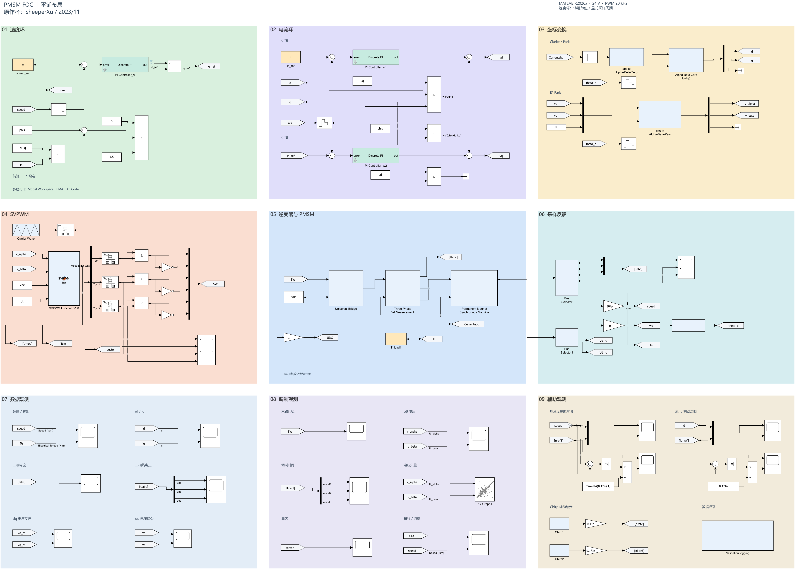

# PMSM FOC：当前 R2026a 模型

当前入口为 **`PMSM_FOC_R2026a.slx`**，保留原模型的小模块、内部实现及控制连接，以九个等宽等高色域平铺展示。原仓库的模型文件保留在 `2_PMSM_FOC_MATLAB/`。

2026-10-11：已完成[速度环单位与采样修复](control/README_速度环第一步.md)，保留 164 个顶层块、165 个内部块及现有布局。数学和采样检查通过，动态响应仍需整定。



## 打开与运行

环境：MATLAB R2026a + Simulink，已在 R2026a Update 5 验证。不需要 Simscape Electrical、DSP System Toolbox 或 Motor Control Blockset。

克隆仓库后，在 MATLAB 中进入仓库的 `modern` 文件夹，运行：

```matlab
open_pmsm_model
```

也可直接双击 `PMSM_FOC_R2026a.slx`，点击“运行”。参数已嵌入 Model Workspace，不需要先运行原参数脚本。入口：Model Explorer → PMSM_FOC_R2026a → Model Workspace → MATLAB Code。

默认设置：24 V 母线、3000 rpm 转速给定、20 kHz PWM、50 μs 控制周期、ode4 固定步长 1 μs、仿真 1 s。电机参数为演示值，尚未标定为实际电机。

```matlab
pmsm_result = sim('PMSM_FOC_R2026a');
plot(pmsm_result.log_speed.Time, pmsm_result.log_speed.Data);
xlabel('Time (s)'); ylabel('Speed (rpm)'); grid on;
```

## 当前实现

旧 SPS 电机、逆变桥和坐标变换等已用普通 Simulink 块替代；电机使用连续 dq 方程，逆变器使用六路互补门极驱动的理想开关桥。原控制结构保留；速度 PI 增益已按转矩输出统一，采样周期参数已连接到实际离散块，转矩换算中的电感项已改为 Ld−Lq。电流环、前馈和原 SVPWM 算法继续审查。

画布顺序：

| 位置 | 左 | 中 | 右 |
| --- | --- | --- | --- |
| 第一行 | 速度环 | 电流环 | 坐标变换 |
| 第二行 | SVPWM | 逆变器与 PMSM | 采样反馈 |
| 第三行 | 数据观测 | 调制观测 | 辅助观测 |

模型共有 164 个顶层块、165 个内部块，九个色域大小均为 860 × 580。

## 验证记录

- `validation_results.json`：默认运行、零指令、反转、负载突变、求解步长减半共五个工况的检查结果。
- `validation_waveforms.png`：默认工况和负载突变波形。
- `layout/flat_tidy_verification.json`：修改前学习快照的布局验证；当时布局整理前后 12 路记录逐点相同。当前速度环算法修复会改变波形。
- `control/speed_loop_stage1_results.json`：速度环单位修复、十组 PI 逐拍测试、实际采样周期检查，以及修改前后动态比较。
- `control/speed_loop_stage1_reload_check.json`：关闭后重新加载，嵌入参数、编译周期、块数量及库链接检查通过。

五个已列工况均通过脚本中的有限值、转速跟踪、门极互补和 PWM 阈值检查，未解析库链接为 0。这些检查不覆盖全部控制边界，也不代表真实硬件验证。

当前默认启动峰值约 3261.63 rpm，超调约 8.72%；负载阶跃后最大速度偏差约 95.07 rpm。这些动态指标尚未按硬件目标验收。下一步应核对速度 PI 的积分饱和恢复，并重新整定动态响应。

在 `modern` 文件夹中重跑：

```matlab
validate_pmsm_r2026a
```

脚本会更新结果 JSON 和波形图，并生成本地 MAT、CSV 数据。布局验证 JSON 是历史比较记录，复现其前后比较需要本地整理前备份。

## 已知问题与下一步

当前可用于读懂控制链和开展仿真开发。算法专项审查发现的问题尚未修改：

1. 改善速度环启动、反转和饱和恢复的动态响应，定义性能验收指标。
2. 修正 d 轴 PI 参数绑定。
3. 核对 dq 解耦前馈，并补充最终电压矢量限幅与抗积分饱和。
4. 修复 SVPWM 过调制的顺序归一化问题，补充边界工况验证。
5. 根据 STM32G474RET6 固件和实际电路接入 PWM 更新、ADC 采样、角度测量、死区与器件非理想因素。

当前理想桥没有死区、器件损耗或采样电路模型；Chirp 为辅助观测信号，没有接入主控制给定。尚不能作为已完成开发板适配的发布基线。

速度环当前状态见[第一步说明](control/README_速度环第一步.md)。[逐模块解读](../review/learning/PMSM模型逐模块解读.md)与 Word 文档保留修改前学习快照的说明；其余开发安排见[STM32G474 开发计划](../review/learning/STM32G474仿真开发计划.md)。原作者 SheeperXu；迁移和修复基于原仓库模型。

当前模型 SHA-256：`57049d757a95e7d2674a6ad8d99165c5b1eb71985704233892192f3fc0103d5d`。
