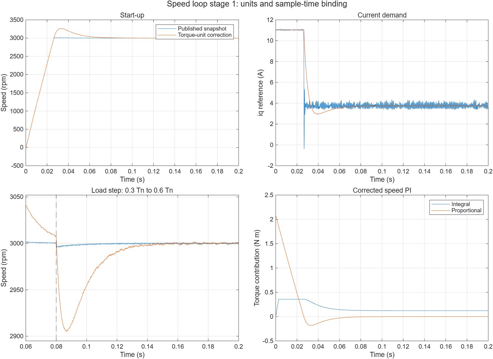

# 第一步：读懂并修正速度环

本次在 `../PMSM_FOC_R2026a.slx` 上修改速度环，保留平铺布局、小模块名称、SID、层级与连接。修改前版本为 Git 提交 `4394283`。结果以 `speed_loop_stage1_results.json` 为准；逐拍检查入口是 `validate_speed_loop_stage1.m`。

## 已执行结果及性能边界

十组 PI 输出及积分状态与独立计算的最大差异约 1.45×10⁻¹⁵ N·m；50 μs、100 μs 两种周期的编译检查通过；五个闭环工况的数值与末段跟踪检查通过。保存后重新打开，嵌入参数及 329 个块的检查通过。

| 默认 3000 rpm 工况的指标 | 修改前学习快照 | 单位修正后 |
| --- | ---: | ---: |
| 末 20 ms 平均转速 | 3000.003 rpm | 2999.968 rpm |
| 启动峰值 | 3017.118 rpm | 3261.629 rpm |
| 启动超调 | 0.571% | 8.721% |
| 启动进入并保持 ±2% 的时间 | 25.95 ms | 55.35 ms |
| iq_ref 最大绝对值 | 11.1097 A | 11.0400 A |
| 0.08 s 负载阶跃后的最大速度偏差 | 5.706 rpm | 95.065 rpm |

反转 −1500 rpm 工况的最低转速约 −1781.05 rpm，按转速幅值计算的超调约 18.74%。现有闭环“通过”条件不包含超调和负载跌落验收，不应据此认定动态性能已达标。

本次纠正的是物理单位和参数连接，没有按原来的速度曲线反向调参。增益变小后，iq_ref 的高频抖动减少，启动和负载动态也发生变化。下一步应结合积分状态和限幅记录，检查饱和恢复并整定响应，再把动态指标纳入回归检查。



主模型校验值：`57049d757a95e7d2674a6ad8d99165c5b1eb71985704233892192f3fc0103d5d`。

## 先沿着这条链阅读

```text
转速给定 n [rpm]
    ↓ 与采样后的实际转速相减
速度误差 e [rpm]
    ↓ 速度 PI
转矩给定 Te_ref [N·m]
    ↓ 除以转矩系数
q 轴电流给定 iq_ref [A]
```

速度环回答的是“为了追上目标转速，需要多大电磁转矩”。后面的电流环再回答“为了产生这些电流，需要施加多大电压”。这一步保留原图中的转矩换算支路，让每个量有统一的物理单位。

## 1. 原增益为什么需要修正

机械方程为：

```text
J · dωm/dt = Te − TL − F·ωm
n = (30/π)·ωm
```

忽略负载扰动时，转矩到转速的对象为 `(30/π)/(J·s+F)`。如果 PI 直接输出电流，对象中还要乘转矩系数 `Kt=1.5·p·phis`。

原参数使用了包含 Kt 的电流输入对象来计算 PI 增益，原连线却把 PI 输出命名并限幅为转矩，再除以 Kt。因此，本次按现有“PI 输出转矩”的连线统一增益。

保留原设计中的频率参数与 PI 零点关系：

```matlab
wsc = 2*pi*fwb;
K = 30/pi;
Kt = 1.5*p*phis;
kp_w = J*wsc/K;
ki_w = kp_w*wsc/5;
```

这里的 `fwb=50 Hz` 是保留的设计频率参数；实际闭环带宽还受电流环、摩擦、采样及饱和影响，未通过频响辨识确认。

| 项目 | 修改前 | 修改后 |
| --- | ---: | ---: |
| Kp | 0.0213232193851，按电流输出推导 | 0.000690872308076 N·m/rpm |
| Ki | 1.33977738742，按电流输出推导 | 0.0434087873524 N·m/(rpm·s) |
| 转矩给定限幅 | ±0.357696 N·m | 保持 ±0.357696 N·m |
| 默认执行周期 | 内部实际为 50 μs | 显式定义为 50 μs |

例如误差为 100 rpm，只看比例项：修正后提出约 0.06909 N·m，对应约 2.132 A 的 iq 给定。原接法的比例项会提出约 2.132 N·m，并立即触及转矩限幅。转速最终能跟踪，不足以验证这个单位约定。

## 2. 抗饱和系数怎样处理

原内部结构保留：

```text
u_lin = Kp·e + xI
u_sat = clip(u_lin, 下限, 上限)
积分输入 = Ki·[e − Ks·(u_lin−u_sat)]
```

为了在单位转换时保留原来的回算速率，Kp、Ki 相对原值乘 Kt，Ks 相对原值除以 Kt。因此 `Ki·Ks` 保持不变；本次没有重新设计抗饱和强度。

```matlab
ks_w = 1.5*kp_w/(Kt^2);
```

修正后的 Ks 约为 0.987186 rpm/(N·m)。积分状态限幅和后向欧拉方法保留。现有回算速率较慢，是否调整应在后续饱和恢复专项验证中决定，不能把“单位正确”当作“抗饱和已经优化”。

逐拍测试以当前误差求解后向欧拉隐式方程，并考虑积分状态限幅和总输出限幅。t=0 按现有积分器 `InitialConditionSetting=Output` 使用零初始积分输出。[MathWorks 离散积分器说明](https://www.mathworks.com/help/releases/R2026a/simulink/slref/discretetimeintegrator.html)

## 3. 转矩怎样换成电流

与当前电机方程一致的关系为：

```text
Te = 1.5·p·[phis+(Ld−Lq)·id]·iq
iq_ref = Te_ref / {1.5·p·[phis+(Ld−Lq)·id]}
```

原 `Constant3` 的值由 `Ld` 改为 `Ld-Lq`，其余乘法、加法和除法块保留。当前 Ld=Lq，分母就是 Kt=0.0324 N·m/A；即使实际 id 有纹波，也不应让表贴式电机的转矩系数跟随它变化。

当前转矩给定上限对应 iq_ref 约 ±11.04 A。它是控制给定范围；实际电流的瞬态峰值需要单独观察。后续推广到凸极电机、弱磁或 MTPA 时，还需协调电流限幅和换算分母的有效范围。

## 4. 采样参数怎样真正生效

原面板 `SampleTime=1/fwb=20 ms`，内部积分器和比例保持却直接引用 dt=50 μs。本次分别定义设计频率和执行周期：

```matlab
fwb = 50;          % 设计频率参数 [Hz]
Ts_speed = dt;     % 速度环执行周期 [s]，当前 50 μs
```

速度 PI 面板引用 Ts_speed；内部积分器、比例保持引用面板的 SampleTime；顶层速度反馈保持也引用 Ts_speed。

测试会把 Ts_speed 临时改成 100 μs，检查编译后这三个离散块的实际周期是否一起变化，再恢复 50 μs。100 μs 是参数生效检查，不是开发板频率选型。实际频率等待固件任务调度确认。

## 验证及阅读结果

在 MATLAB 的 `modern` 文件夹中运行：

```matlab
addpath('control');
speed_component_report = validate_speed_loop_stage1;
validate_pmsm_r2026a;
```

组件验证包括零误差、线性区、正饱和、负饱和、饱和反向各五种输入，在 50 μs 和 100 μs 两种周期下共十组逐拍对照；还检查编译周期，以及非零 id、Ld≠Lq 时的转矩换算表达式。

`speed_loop_stage1_results.json` 保存本次修改前后的参数、结构检查、组件验证、五个闭环工况结果和动态指标。`speed_loop_stage1_comparison.png` 是相同输入下的启动及负载阶跃比较。

启用了 `logsout`，增加 `speed_Te_ref`、`speed_P`、`speed_I` 三路日志，通过信号记录实现，没有增加控制模块。结构比较忽略 R2026a XY Graph 每次运行自动生成的 SignalIDs；其输入接线和实际控制参数仍检查。

`repair_speed_loop_stage1.m` 只接受修改前快照的校验值，执行通过后才保存主模型。已经修复的模型不要重复运行迁移脚本；后续使用验证入口。比较所用修改前日志和备份保存在本地 `.build/speed_loop_stage1/`，日常运行不依赖这些文件。

下一步仍需处理 d 轴 PI 参数绑定、完整 dq 前馈、电压矢量限幅、SVPWM 过调制以及与它们一致的抗积分饱和。硬件参数、PWM/ADC 时序和测量链也尚未接入。
