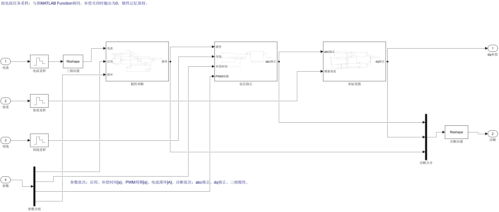

# 补偿逻辑展开与局部布局

状态：已验证的本地候选，尚未替换主文件。用户决定布局与理线后续统一处理，当前主线继续研究死区补偿性能。本页“展开实现”指`.build/readable_compensation/PMSM_FOC_R2026a.slx`候选，当前主模型仍保留原MATLAB Function实现。

原“死区补偿”使用一个MATLAB Function实现，因此画布上只能看到输入/输出，算法需进入代码才能阅读。本轮把相同算法展开成普通Simulink模块，保留“电流环 → 限压 → 死区补偿”的位置；主画布九宫格、原PI、设置开关、参数及电机模型不变。

双击“死区补偿”，从左到右依次阅读三个阶段：

1. **极性判断**：测量三相电流与±h比较，带内保留上次极性。Unit Delay只存上次结果，本拍输出由本拍判断直接生成，并未额外引入一个控制周期延迟。补偿关闭时记忆保持、输出为0。
2. **电压修正**：`max(Vdc,0)*tcomp/Tpwm`形成幅值，乘各相极性后减三相均值，得到abc电压修正。
3. **坐标变换**：普通Fcn、sin/cos、乘法和加法块实现原Clarke/Park约定，使用测量角度，输出dq修正。

输入电流、角度、母线按原`timing_control_sample`采样。诊断仍为abc修正、dq修正、极性，共8项，原日志和“功率观测”接口保持。

例如母线24V、PWM周期50μs、补偿时间2μs，原始补偿幅值为0.96V。若三相极性为[+1,-1,-1]，去均值前为[+0.96,-0.96,-0.96]V，去均值后为[+1.28,-0.64,-0.64]V。随后使用测量角度转换到dq，与电流环电压请求相加，最后一起限压；右侧诊断支路仅记录这些中间量。

“限压”内部整理为上方dq请求/补偿相加/最终输出，中下方电压能力与比例，右侧诊断记录。原小模块保留；只移动内部位置及重新布线，主画布不变。关键功能不是截图上的示意，已经直接存在于SLX内。

## 效果与下一步

本轮改变可读性，没有更换补偿算法，也没有调整PI。2μs的600rpm/0.207N·m历史对照仍是THD约6.53%→4.11%，300rpm/0.08N·m边界工况约11.11%→16.04%，后者补偿变差。放大死区也放大了基础极性补偿的局限。

下一步先对照真实电流、测量电流、所判极性和实际PWM生效时刻，定位过零附近判断与生效是否错位；再单独对照补偿时间和滞环。暂不同时加入预测器、观测器或谐波控制器，以便每次复杂度增加都能解释和回退。

## 验证范围

记录见`readable_compensation_results.json`。包含原/展开实现的组件对照（过零、启停记忆和负母线钳位）、2μs补偿闭环短时记录对照、关闭回归、保存重载、原设置与外部模块连线/参数、PI和主布局检查。组件按相同控制采样时刻比较；原cfg是运行前配置，不支持运行中任意改采样周期。

闭环开启对照时长10ms，52路记录时间戳一致、最大数值差约1.47e-10；关闭对照时长3ms，52路记录逐点相同。这是本次实现等价性检查，表中的长时稳态THD来自上一版相同算法的历史教学报告，没有作为本轮新算的指标。

代码`deadtime_comp.m`保留为当前主模型实现的源码和候选的独立对照；候选内该位置已替换为普通模块。更早的死区验证和教学波形保留为历史算法证据，不能把旧模型指纹当作候选SLX指纹。
