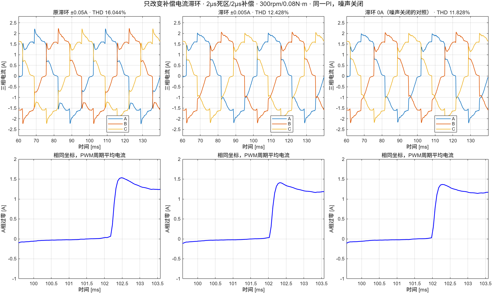
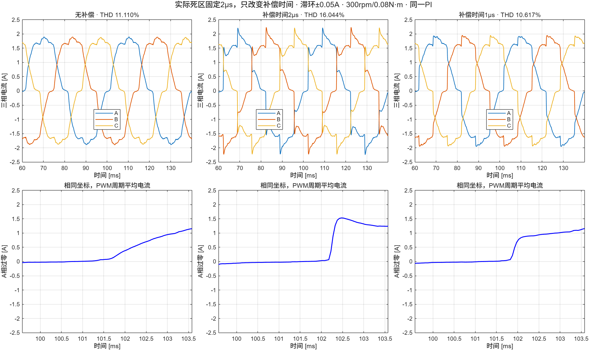

# 过零诊断与补偿单因素对照

2026-10-12：按用户要求，布局和理线后续统一处理，当前主线先推进死区补偿性能。所有本轮实验在当前主模型`a0f7cbae...`上临时选择参数，未覆盖SLX、未调整PI、未引入新控制算法。

## 先确认现象

`report_zero_diagnosis`重分析现有0.5μs/600rpm与2μs/300rpm记录。末两个电周期内，每相补偿极性均反转4次，没有发现极性反复抖动。PWM尾段事件记录的JEOS至CCR生效延迟为21.125μs。低速轻载的电流在零附近长时间停留，极性维持到电流越过滞环后才切换，随后abc/dq补偿有阶跃。

这些证据不能把平台归因于单一的21.125μs延迟，也不能证明近零二极管数值模型完全准确。平均电流方向仅用于离线诊断，从未接入控制器。原历史测量日志未假定与补偿任务同相位；本轮新实验把测量电流日志临时对齐到实际补偿采样时刻，并逐拍重放滞环判断，确认输入能重现实际极性。

## 单因素结果

实际门极死区均为2μs，母线24V，PWM 20kHz。600rpm负载0.207N·m；300rpm负载0.08N·m。速度任务、真实PWM/ADC时序、初始工作点和PI均一致，噪声、器件压降等其他因素关闭。

| 补偿设置 | 600rpm低次THD | 300rpm低次THD |
| --- | ---: | ---: |
| 无补偿（历史参考） | 6.528% | 11.110% |
| 补偿2μs，滞环±0.05A（历史参考） | 4.110% | 16.044% |
| 补偿2μs，滞环±0.005A（本轮） | 3.336% | 12.428% |
| 补偿2μs，滞环0A（本轮） | 未测试 | 11.828% |
| 补偿1μs，滞环±0.05A（本轮） | 3.999% | 10.617% |

缩小滞环减少了一部分误差，但低速轻载仍未优于无补偿。减半补偿时间缓解过补偿，但低速改善很有限。不能据此把1μs称为板上的真实有效死区，或宣布某一参数适合所有工况。零滞环只在噪声关闭时作为诊断对照，不作为带噪实板默认值。





THD继续使用PWM周期平均A相电流、真实电角度拟合2—25次谐波、末两个电周期，排除开关频带。每组300rpm仿真140ms，600rpm仿真80ms。旧参考与新记录的来源、文件指纹、分析区间见各`results.json`，历史参考不是本轮重跑的结果。

## 复现与验证

在modern目录中：

```matlab
addpath('deadtime'); addpath('teaching')
% report_demo/.build/deadtime_demo是可覆盖缓存；先准备匹配的参考。
run_deadtime_demo(2,300,.08,.14,struct('comp_us',2,'hysteresis_A',.05))
compare_deadtime_hysteresis
compare_deadtime_amplitude
validate_deadtime_probes
```

`run_deadtime_demo`新增可选第五个参数，明确传入补偿时间与滞环，报告记录实际选值。例如`struct('comp_us',1,'hysteresis_A',.05)`。不传该参数时保持旧行为：补偿时间跟随输入死区、滞环读取原功率设置。设置入口本身没有改变。

`check_low_deadtime_reference`检查缓存工况、补偿设置以及MAT指标与record是否匹配，拒绝混用另一个工况。`parameter_probe_validation.json`另检查仅改变两路观测日志的采样相位不会改变其他50路闭环记录，并验证配置、嵌入工作区代码及主文件指纹保留；新参数图例已渲染复核。

三相教学图的过零窗口现在选取三组数据均完整覆盖的内部交点，局部纵轴统一并覆盖三组窗口内峰值，避免选到仿真结束边界产生留白，或截去补偿后的突变。这只修正显示范围，未修改波形或指标。

## 后续候选：过零处理（已暂缓）

2026-10-12用户调整优先级：先完善框架、开关及固定开发基线，暂停具体算法优化。以下保留为历史研究设想，尚未实施，不作为当前开发任务；最新安排见[框架与开发基线](../teaching/README_框架与开发基线.md)。

保留原“极性滞环”方法作为默认和对照，先研究零附近逐渐降低补偿幅值，远离零点仍恢复原幅值。新增复杂度限定为一个方法选择和一个过渡电流宽度，不增加观测器、不改PI、不引入额外控制拍延迟。具体函数和参数尚未写入主模型。

[MathWorks原补偿器文档](https://www.mathworks.com/help/mcb/ref/deadtimecompensator.html)说明滞环用于改善有噪声时的极性判断。[Chen等2022年论文](https://www.mdpi.com/2076-0825/11/9/267)的式24采用近零二次衰减的补偿函数，为下一步提供思路；这里只参考过零幅值处理，不复现其滑模观测器或照搬论文电机参数。

下一次验证应覆盖600rpm和300rpm两组、正常0.5μs与教学2μs死区，分别检查低次THD、dq电流、转矩波动及补偿波形；再单独打开噪声测试。近零续流数值带还需做敏感性检查，避免把数值近似的变化误认作控制算法收益。完成这些对照后，再确定教学默认参数与实板校准方法。
