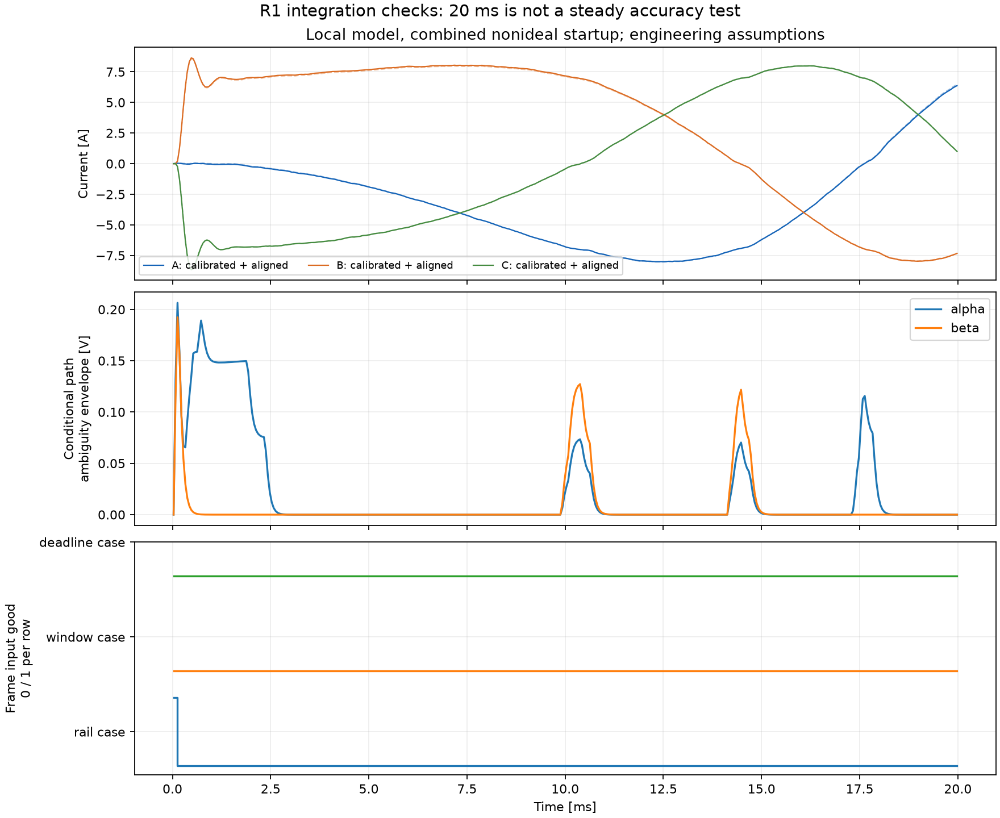
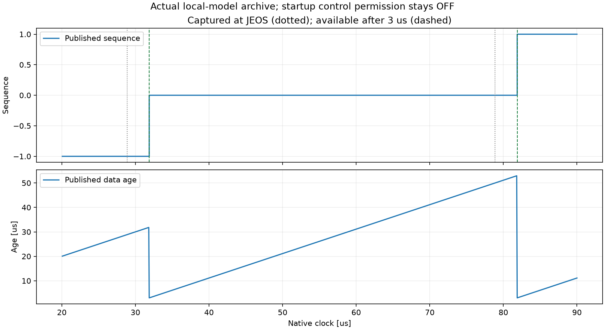
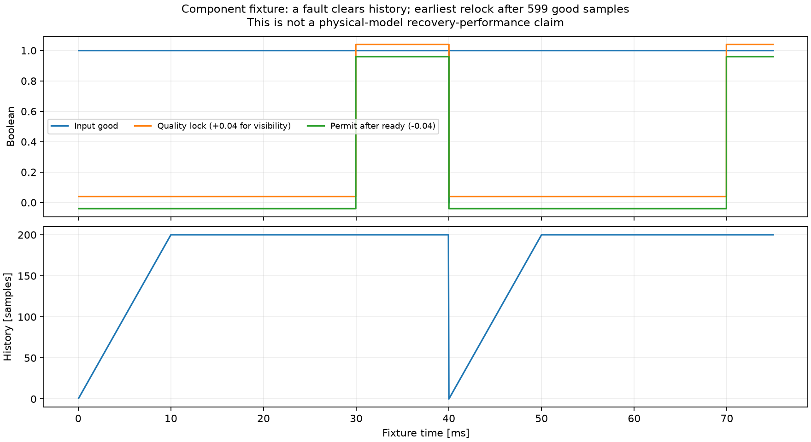
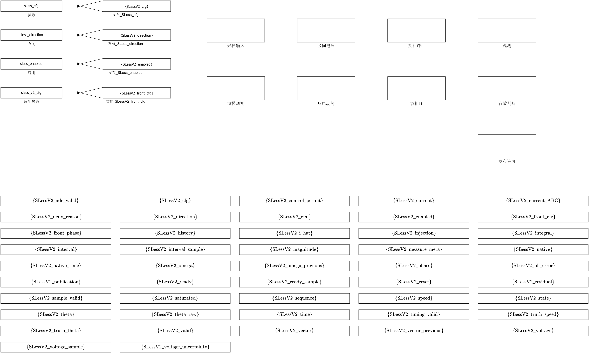

# N3R1：非理想条件下的本地适配接入

当前：**R1接入、组件复现、四工况完整复现与原52路回归通过，待用户验收**。用户已接受R0并授权本节点；未进入R2。候选实现提交`75f03bc`，正式执行前冻结文件清单见[N3R1/frozen_candidate.json](N3R1/frozen_candidate.json)。

## 本节点交付

在本地主模型内生成可撤销的“非理想无感旁路”，复用本地N1数学核心和N2布局，不复制Ref电机模型。47个内部Goto均为作用域标签；原有模块、算法、PI和SLX保持。新增原生2×2“许可与节拍”Scope，区分观测锁定、控制许可、禁止原因和数据年龄。

实现三相标定、偏置启动响应处理、先后采样的因果时间对齐；重构电压经过估计模拟/数字前端滤波，与滤后电流匹配，再用历史估计频率单独补偿前端相位。电流符号在原生节拍上预测，保留零流续流歧义及跨滤波区间的条件包络。真实参数和观测端估计参数独立，4500/5000Hz模拟滤波、0.4375/0.5μs死区和压降参数故意不相等。

JEOS参考28.875μs，观测预算3μs后在31.875μs发布，FOC预算5μs后36.875μs写CCR，正常50μs生效；2μs只作裕量。新包完成前不可读，ADC/时序故障能独立撤销旧包许可。新增故障恢复锁存，先看到解锁新包，再看到重新锁定新包才恢复许可；不沿用故障前历史。

## 冻结的验收与证据边界

[原定R1测试标准](../contracts/nonideal_r1_test_plan.json)在实施前冻结，未改动。四个20ms工况分别为正常组合、ADC量程±0.2A削顶、窗口不足、写入恰好触及48μs裕量截止期。窗口开启的初始短工况未产生坏窗口，原失败记录保留；[执行前补充刺激](../contracts/nonideal_r1_window_addendum.json)明确把诊断窗口的连续低侧稳定要求设为25μs，保证故障可观测。该25μs不是实测前端指标；正常工况仍用0.5μs。

每个工况要求独立正式轮、独立复跑、同配置未装观测器基线；完整Time/Data逐点相等，并检查原有全部52路日志。跨进程核验在第三个新进程中执行。显式原生异常仅允许一次重试，数值失败不重试选优。开发失败及源码版本另记，不用于替代正式证据。

20ms主模型运行只验证接入、因果性、故障入口、回归与恢复原模型；此时观测质量尚未锁定，控制许可应关闭。599个连续好样本后的重新许可在明确标注的组件夹具验证，不冒充主模型动态恢复性能。小数值残差是公式/代码一致性，不是对真实电压、角度或速度的精度。

## 正式结果

[完整跨进程核验](N3R1/verification.json)、[15个独立进程执行记录](N3R1/campaign.json)、[具名参数与实际设置](N3R1/effective_parameters.json)。正式轮所有作业第一次即通过，无原生重试。每个观测工况保留87路完整日志、320001个原生时刻及400个控制数据包。源码85个M文件、9个契约/输入文件均归档并逐次核对指纹。

|工况|削顶帧|无效窗口帧|截止期失败帧|完整复现|原52路正式/复跑回归|
|---|---:|---:|---:|---|---|
|正常组合|0|0|0|逐点相等|逐点相等|
|ADC削顶|398|0|0|逐点相等|逐点相等|
|强制窗口不足|23|400|0|逐点相等|逐点相等|
|48μs裕量边界|0|0|400|逐点相等|逐点相等|

所有20ms主模型运行中控制许可均为0，符合尚未完成锁定的启动状态；故障场景未把默认数值当作可用估计。完整复现总计**116,101,296**个Time/Data数值；原52路正式与复跑对基线总计**80,902,920**个数值，严格`isequaln`，不使用容差比较。

[组件指标](N3R1/component_metrics.json)：300帧三相标定、6000帧正弦对齐、41个带符号频率相位点、4801个原生电压样本、6个量程边界、1601个延迟/实时故障样本、1500帧质量锁定与发布恢复轨迹。正弦对齐误差最大0.0010891A（预定上限0.03A）；相位公式与独立复传递函数误差5.63×10⁻¹⁷rad。其他标定/区间递推均在原定10⁻¹⁰容差内。这些数值是解析夹具与公式一致性，**不是主模型角度或实板精度**。

主模型独立原始日志审计确认：校准/对齐递推误差≤1.85×10⁻¹⁴A；原生门极与独立边沿计数判定完全一致；无歧义桥状态电路方程误差≤7.11×10⁻¹⁵V；RC、数字滤波、RL区间和条件包络递推误差≤7.06×10⁻¹²V。发布/写入相对预定时刻误差均低于10⁻¹²s。仍不能据这些“代码计算对上了”的误差宣称重构电压等于真实端电压。

正常组合中的续流歧义原生时刻占比约0.2825%，滤后条件包络峰值0.20641V；全部保留，未删除零交越样本。该包络未覆盖真实参数失配和预测电流误差，R2需要用真实电压/电角度作仅评价用途的独立精度检查。





首包之前序号为−1，年龄字段相对默认零参考，仅为诊断占位，不表示已有可用包；许可仍关闭。



组件图按样本编号×50μs表示夹具时间；原始原生队列时间另存于组件MAT，主模型发布图直接采用实际原生时间戳。所有图由归档CSV生成，来源指纹见[N3R1/figure_provenance.json](N3R1/figure_provenance.json)。

原SLX SHA保持`a0f7cbae9e7c334c25aa9dcf6e7e88d65fd89bd1888a0fa2ec0cd04f6cce262d`；N0全部651项、617个旧源码、4个v1契约及R0的9个M文件指纹保持。每次撤层/恢复刺激后结构、回调及工作区恢复；既有用户GUI会话未改动。开发失败、一次原生异常及修正路径见[执行历史](N3R1/execution_history.json)。MATLAB原生异常根因未确认；正式deadline基线另出现Arrow执行计划销毁诊断，运行完成且严格回归相等，原日志保留，不据此宣称环境异常已根治。

## 复现与查看

查看排版脚本独立于冻结算法，统一九个模块和47个标签可见域的位置，并检查除位置外的执行图、工作区与撤层恢复保持不变；见[N3R1/presentation_validation.json](N3R1/presentation_validation.json)。



正式入口：`modern/sensorless/run_sensorless_v2_r1.ps1`，会先校验冻结候选，再以各自独立缓存运行所有子进程。数据存在本地`runs/N3R1_formal_20261016_233230_ef2a2a57-ee3e-451c-9850-e101d2101803`；提交指标、日志来源与原始数据指纹，不提交大体积MAT文件。

独立MATLAB会话中：

```matlab
cd('D:/simulink/dev/modern');
addpath('sensorless/review');
pmsm_sensorless_v2_review('open');
% 查看后恢复：
close_pmsm_sensorless_v2;
```

入口拒绝覆盖已加载的用户模型；之前已打开的N2 GUI会话未改动。参数、日志列、角度时间语义和原因位见[适配接口](../robust/integration/INTERFACE.md)。

## 后续仍未完成

原生62.5ns门极、桥和发布检查用于仿真参考及事件核对，不是要求MCU以16MHz执行观测代码。目标固件迁移仍需将这类积分改为PWM边沿分段/事件计算，计入整个观测链并实测最坏总耗时；本节点的3μs/5μs是人为分配的仿真预算，不能作为可直接上板运行的证明。

R2需要1000/2000/3000rpm及反转的长时组合精度、动态、R/L失配、边界死区、低速/停转、实际丢帧/复位、抖动/超时与恢复测试，并遵守新2ms误有效目标；R3冻结最终候选后完成全矩阵复现和同配置原52路回归。当前未切换FOC反馈至估计角，真实MCU耗时、实测ADC/前端、磁饱和/温漂曲线、定点误差与母线测量误差仍未验收。原N3的0μs详细桥复现缺项和整体未通过结论保持。
