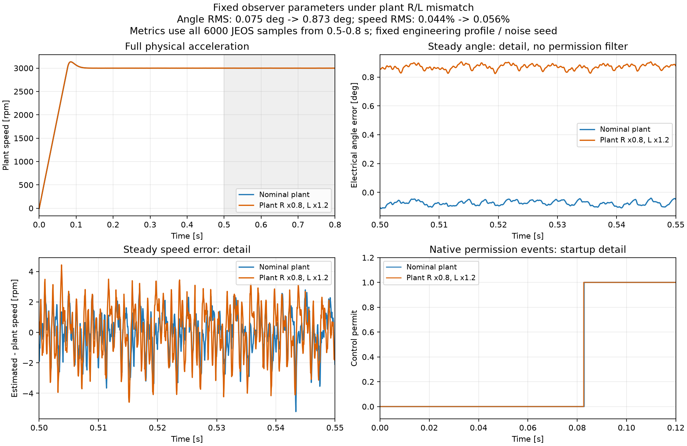

# N3R2 开发进展：动态、参数隔离与故障接口

2026-10-17。接续[五组稳态记录](N3R2_followup.md)。**R2 仍未通过，尚未冻结完整候选或完成最终全矩阵；不进入 R3，不接管反馈。** 本页记录开发证据，不能把不同版本的局部结果合并成最终完整复现。

## 已获得的证据

| 项目 | 当前证据 | 限制 |
| --- | --- | --- |
| 正反转稳态 | 原记录五组 0.8 s 固定窗口通过 | 是开发阶段工况，最终完整候选还须冻结和全矩阵 |
| 2000→3000 rpm、加载至 0.25 Nm | 原始 0.9 s 数据复核通过；变速恢复 32.128875 ms，加载后首个合格 JEOS 为 28.875 μs；全程误有效为 0 | 加载后未离开容差，28.875 μs 不是机械稳定时间或 WCET；实际包发布还晚 3 μs |
| R/L 只改本体 | 电阻 ×0.8、电感 ×1.2 的 0.8 s 工况通过：角 RMS 0.8733°、峰值 0.9119°、速度 RMS 0.05599%、许可 100%、全程误有效 0；观测名义参数保持、恢复通过 | 电阻 ×1.2、电感 ×0.8 的符号绑定路径两次原生异常耗尽，尚无精度结论 |
| 等值数值绑定 | 同四个本体 Fcn，400 次双表达式计算完全一致；编译、名义观测参数和恢复通过 | 尚不能由此认定 MATLAB 原生异常根因或温漂精度通过 |
| 故障纯组件 | 100 个正常输入帧、各 2401 个正常队列/PWM/电压原生时刻与本地 R1 完全一致；丢帧数据独立性、严格未知序号锁存、抖动、写入撞 UEV/跨更新点检查通过 | 599 帧恢复使用合成质量输入，真实恢复必须看完整物理轨迹 |
| 故障接口正常路径 | 20 ms 图检查：已有 90 路日志共 10,191,329 个 Time/Data 值完全相同，含原 52 路；400 次实际发布事件完整 | 该图检查不是完整故障测试 |
| 最终接口短时预检 | 唯一原生重试后通过；含原 52 路的 81 路共同日志、10,145,265 个 Time/Data 值与 R1 完全相同；撤层/配置恢复通过 | 第一次原生异常完整保留，未宣称运行环境已修复 |
| 时序物理执行器 | 编译和恢复检查通过；1 ms 原生事件的实际写入/UEV 时刻符合独立时间戳计算 | 1 ms 未到 0.5–0.7 s 扰动区；负对照确认它不能通过故障验收 |

动态原仿真已完整归档，随后后处理器的空 struct 数组定义错误使原执行失败。只修正分析数组类型，核验原数据 SHA 后重新分析，没有重跑仿真或重写失败状态。原执行未走恢复段；另做无仿真的相同配置恢复探针通过，不能把它回写成原执行端到端成功。[重新分析报告](N3R2/development_20261017/N3R2_dynamic_archive_reanalysis_once/report.json)。

R/L 失配已经出现可量化偏差：角 RMS 从名义本体的 0.0753° 上升到 0.8733°。图中细节窗口用于看波形，表中指标始终使用 0.5–0.8 s 全部 6000 个样本，未按许可筛选；独立 CSV 计算与 MATLAB 指标一致。当前本体 Rs=0.0841 Ω、Ld=Lq=0.0001245138 H；观测/控制名义值仍为 0.105125 Ω、0.0001037615 H。

[图与数据来源](N3R2/development_20261017/cold_comparison_provenance.json)。该工况实际仿真耗时约 29 分钟，不能由仿真墙钟耗时推导 MCU 执行时间。

## 故障适配与观测格式

[故障设计合同](../contracts/nonideal_r2_fault_adapter_design.json)先于实现提交于 `f728558`，阈值仍使用原冻结计划。复用本地 R1 方程，不复制 Ref 模型。

- **缺 5 帧：** 物理 ADC/控制器继续，只切断观测消费者。不可用电流不进入校准、差分历史或电压预测器锚点；已知偏置滤波和因果电压模型继续。声明丢帧时清除旧发布缓存、递增流代次，恢复后重建质量历史。
- **软件复位：** 一个 50 μs 区间，复位 SMO/反电势/PLL/质量判断和电流差分。前端记忆保留，队列在首个原生调用直接否决，不等 3 μs 计算完成。它不代表整板断电。
- **时序扰动：** 只改物理 PWM 事件执行器，在 JEOS 绑定该任务预算，按实际写入读取控制请求，UEV 优先于同刻写入。0.55 s 的 10 μs 阻塞仍在 48 μs 截止期前；0.6 s 起的 13.125/30 μs 阻塞才触发错过截止期。最大总计算时间 38 μs 小于 50 μs 周期，覆盖更新点/截止期跨越，**不宣称是真正中断任务重叠**；不支持的重叠明确拒绝。

新信号继续使用 `SLessV2_` 作用域 Goto，保持九个根模块。原角度 rad、速度 rpm、电流 A、时刻 s 格式保持。新增实际完成发布日志、流代次/故障状态、锚点许可和原生 PWM 事件日志，详细列定义见[接口](../robust/faults/INTERFACE.md)。发生丢帧/抖动时按包内参考时刻匹配 SMO/PLL，不能沿用固定 `JEOS+3 μs` 显示行号做验收。

完整故障验收要求：先有故障前许可，确认故障确实触发，第一原生调用撤销许可，拒绝时控制字段为零，至少 599 个有效采样机会后才能重新许可，并在健康恢复后的 150 ms 内达到连续 20 ms 合格。20 ms 同时核对原生事件中的许可及真值误差，不能只看控制周期采样点。原生全程误有效计数还须与事件区间独立计算一致。

## 保留的开发失败

首次图探针错误使用改名后的标签作为旧模块名称，安装失败；修正为按唯一 GotoTag 定位。时序短探针的物理计算和归档完成，但恢复检查发现 MATLAB Function 改签名后内部 SFunction 位置向下移动 5 像素。独立无仿真结构诊断证明脚本、接线和块集合相同，差异仅此位置；现在同时备份/还原内部布局，后续编译与完整恢复检查通过。两次失败记录和时序短探针原始数据仍保留，未改判。

原模型 SHA 仍为 `a0f7cbae9e7c334c25aa9dcf6e7e88d65fd89bd1888a0fa2ec0cd04f6cce262d`；R1 冻结 90 文件逐个一致，N0 检查 651 项通过。原 SLX 不保存。原两路门极日志的 4000 点截断边界仍保持；R3 原 52 路同配置长时回归尚未执行。

## 正在执行和后续

本次在本地启动串行队列：先等已有温漂/死区/削顶/低速批次结束；如该批因原生异常中止，只补跑尚无归档的独立工况。符号绑定两次原生异常且没有物理归档的 R/L 工况，才允许改用已经验证等值的数值绑定。随后分别运行缺 5 帧、单次复位、调度抖动/超期长工况。每个工况/实现版本最多一次明确原生异常重试；已归档物理结果即使指标失败也不得重新抽取。

入口为 `run_sensorless_r2_pending.ps1`，它串行调用场景、数值绑定和故障执行器，队列自身不判定 R2 通过。每次执行保存源快照/配置/数据 SHA/指标/恢复记录；源变化会阻止下一作业启动。最终还须检查失败、冻结完整候选、完成全矩阵，形成 R2 验收记录后停在用户验收点。

本页来源清单和运行状态快照见[开发证据汇总](N3R2/development_20261017/summary.json)。运行中的记录没有通过结论；本地 `runs/` 保存大数据，Git 只提交指标、来源和复现入口。3/5 μs 为工程预算，后续仍需实测参数、固件实现及 WCET，不作为实板达标。
