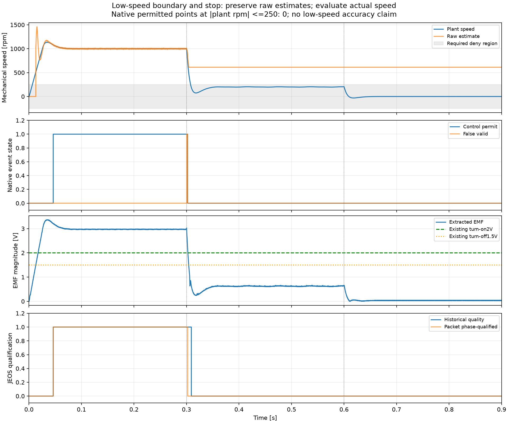

# N3R2 执行补充：低速拒绝与剩余两项

2026-10-17，接续[开发记录](N3R2_development.md)。**开发阶段 11 个长工况端到端通过；动态原始数据指标另行复核通过，但原执行失败状态保持。丢帧、复位仍没有完整可验收轨迹。R2 最终候选未冻结，全矩阵/R3 未完成，未接管反馈。**

## 新完成的长工况

|工况|角 RMS [电角度°]|角峰值 [°]|速度误差 RMS|稳态许可|全程最长误有效|
|---|---:|---:|---:|---:|---:|
|本体 R×0.8、L×1.2|0.873337|0.911920|0.055992%|100%|0|
|本体 R×1.2、L×0.8|1.017688|1.066706|0.039923%|100%|0|
|本体死区 2 μs，估计仍 0.4375 μs|1.027304|1.101639|0.251990%|100%|0|

以上均使用 0.5–0.8 s 全部 6000 个 JEOS 样本，包括无效样本，原阈值不变。加大死区按完整正常精度要求验收，未降低为只看安全拒绝。R/L 仅改本体，控制器/观测名义参数保持。R×1.2/L×0.8 的符号绑定路径两次原生失败后，使用事先验证 400 次表达式完全等值的数值绑定首次完成，原失败路径未第三次重试。

ADC ±2 A 削顶：16000 帧中 15906 帧 ADC 无效，全程控制许可为 0、拒绝时控制字段为 0、误有效为 0，符合冻结的持续削顶拒绝标准。**这是故障拒绝通过，不是估计精度通过**；该工况从启动就削顶，不代表另已验证健康运行后突发削顶及恢复。

调度扰动/超期：实际完成 16000 个包，1 μs 发布抖动被观测到；每个实际 CCR 写入和 UEV 应用时刻均与独立原生节拍计算一致，包含写入恰好撞 UEV 与迟于更新点。故障前已有许可，0.600028875 s 首次原生调用撤销许可；0.700028875 s 健康恢复后，0.730228875 s 参考样本重新满足条件，延迟 **30.2 ms**，实际完成时刻再晚 3 μs，连续 20 ms 原生好状态通过。全程误有效、许可违规和拒绝时控制字段非零均为 0。最大 38 μs 计算预算仍小于 50 μs 任务周期，不宣称是真正中断任务重叠。

这些结果加上原五组正常正反转和下述低速停机，共 11 个长工况端到端通过。全部是固定工程配置/固定噪声种子的证据，尚无实板精度或 WCET 结论。[来源与指标汇总](N3R2/development_20261017/summary.json)。

## 低速与停机：拒绝通过，原始估计并不理想

v8r1 首次完整计算 0.9 s、14,400,001 个原生时刻、18000 个 JEOS 样本和 36004 个事件。实际 |rpm|≤250 时的原生许可违规计数为 0；0.7–0.9 s 连续 200 ms 满足实际 |rpm|≤10 的停机要求。全程许可违规、拒绝时非零控制字段均为 0。低速边界工况按冻结的拒绝标准通过，不宣称低速估计精度通过。

减速期间最长误有效 **1.869875 ms**，主要由速度瞬态误差引起；比 2 ms 参考上限仅低 **0.130125 ms**。全程有许可点的最大相角误差 7.258°、速度相对误差 27.692%，因此不能概括为“全程精度良好”。反电动势不足后，PLL 原始速度停在约 600 rpm，许可已撤销、控制字段清零。此时不以平滑的显示速度冒充真实估计，也没有新增依赖真实转速的运行门槛。

图来自已归档数据，未重跑仿真。低速交界本身不触发事件日志，图中事件采样为状态变化及 50 μs 心跳；低速许可计数以原生累加器为准。[数据、绘图来源与图指纹](N3R2/development_20261017/N3R2_v8r1_remaining_low_speed_stop_20261017_163457_4337288b-e208-4b11-b0c6-1214fbcb8cf1/low_speed_stop_attempt_1/review/low_speed_diagnosis.json)。

## 未完成的执行与新入口

|工况|原路径结果|当前处理|
|---|---|---|
|低速/停机 v5|两次 0xc0000005，最后记录在 simulate，无物理归档|原路径停止；用新生命周期入口验证|
|缺 5 帧 v7|首次 0xc0000005，第二次 0xc0000096，无物理归档|第二种异常不可重试，原路径停止；不把驱动的可重试分类 false 说成没有原生异常|
|复位 v7|两次 0xc0000005，最后记录在 simulate，无物理归档|原路径停止；用新生命周期入口验证|

丢帧第二次原生输出有 `SLBlock::getCompInputPortWidth` 符号。这只能支持检查编译数据生命周期，不能据此宣布根因。旧工作器显式 update 后再 sim，新入口改为观测层安装完成后只 initialize 一次，读图和工作区后推进同一个编译态。使用 R2026a 的 [Simulation](https://www.mathworks.com/help/releases/R2026a/simulink/slref/simulink.simulation.html) / [step](https://www.mathworks.com/help/releases/R2026a/simulink/slref/simulink.simulation.step.html)，不启用 fast restart，不改求解器、状态、节拍、增益或门槛。实施前合同为 `4325a7c`。

实际小模型验证：离散、连续及偏移采样 424 个 Time/Data 数值完全一致；Init/Start/Stop 回调各一次；101 个主步包含 0 和 0.01 s 终点，参数恢复。先后保留一个解析错误和一个终点假设错误：最后一步后本机 API 返回 inactive、下一步时间 NaN，已按原始输出末时刻和原生计数判定终点，不把 NaN 当作真实仿真时间。修正依据已先登记。

第一次主模型短检在安装阶段遇到 Windows 260 字符编译路径限制，未启动物理计算。新 `v8r1` 使用逐次独立的短缓存路径，加载前检查代表性生成路径 <240 字符；原失败记录保留。第二个入口的 20 ms 物理计算、320001 原生时刻、指标与完整恢复均成功，随后记录格式比对发现下述差异，原流水仍保持 failed_execution。

## 两路原日志的格式适配

94 路完整 Time/Data 直接严格相同；另外两路原门极日志也都是 4000 点、Data 严格相同、整数原生节拍严格相同，仅 Time 的浮点编码不同：旧 sim 用均匀 `TimeInfo.Increment=62.5 ns`，对象入口用密集 Time，最大差 **3.4694469519536142e-18 s**。

原始 API 档不改写。按实施前登记的[格式合同](../contracts/nonideal_r2_v8_uniform_log_format.json)，派生档仅将这两路时间编码为 `round(rawTime(1)/h)*h+(0:N-1)'*h`，并验证原容量/点数/连续整数节拍、Data/类型/尺寸不变、时间差 ≤4 ULP。没有截点、插值、重采样或许可筛选，其他 94 路不变。

派生档严格通过完整 96 路及 R1 81 路 Time/Data 比对（含原 52 路）；没有重跑仿真，原始档 SHA、原记录和原流水失败保持。报告明确 `analysis_only`，不是把原执行回写为端到端成功。[归一化和严格比对证据](N3R2/development_20261017/N3R2_v8r1_short_20261017_162814_c6e0244a-576c-4beb-9594-d644dfc04eec/r1_short_logging_check_attempt_1/log_format_recovery.json)。代码、单位和入口见[接口](../robust/execution_v8/INTERFACE.md)。

## 接下来的验收

v8r1 剩余队列已结束：低速通过；丢帧两次 0xc0000005（安装、初始化后推进）后停止；复位推进到 0.07 s 后退出 **0x80000003**，按规则不允许第二次尝试。没有完整物理归档的后两项不能评价恢复性能。不会在旧版本上继续重试。

下一项是单因素执行诊断，先登记合同 `b4fcec3`，再实现 `8a1f9e4`：只在私有内存模型中关闭 `BlockReduction`，显式恢复原值；保持一次初始化、短缓存、全部数学核心和阈值。MathWorks 将该选项定义为执行图的块消减优化，并给出调试时关闭的建议；这只支持将它作为诊断因素，不能证明本机原生异常与它有关。[官方说明](https://www.mathworks.com/help/releases/R2026a/simulink/gui/blockreduction.html)。

新的 20 ms 正常短检已完成：320001 个原生时刻、96 路完整 Time/Data 共 10,203,729 个数值严格一致；原工作区、图、回调及 BlockReduction=on 恢复。随后才启动丢帧/复位。丢帧首次安装异常、第二次最后记录 0.14 s，均为 0xc0000005，已到上限停止；复位两次同样为 0xc0000005，最后保存的下一主步时间分别为 0.73 s、0.65 s，均无完整归档；已到上限停止。该结果说明关闭模块消减未消除原生异常，不是环境修复成功。每工况每版本最多两次、仅明确 0xc0000005/0xc000001d 可第二次；其他退出立即停止。短检不一致时不启动长工况，也不调参数凑一致。[实施前合同](../contracts/nonideal_r2_block_reduction_diagnostic.json)。

[异常清单](N3R2/development_20261017/native_execution_inventory.json)仅包含已结束尝试的退出码、最后保存阶段/进度、私有日志指纹及脱敏模块/符号。驱动的 `native_failure` 表示能否按规则重试，不表示其他 Windows 原生异常不存在；最后保存进度也不是精确崩溃时刻。原始控制台和转储不入 Git，符号不能单独用于归因。

本单因素诊断已结束，当前没有长仿真在运行。下一步转向缩小原生崩溃复现用例及核查运行环境，不再用更换开关或版本标签重新尝试这些长工况。正常短检可完成与长工况间歇中断同时存在，不能据此认定观测算法正确、错误或硬件损坏。MathWorks 说明发生内部错误后该进程状态不再可靠；保留独立进程与私有日志的做法符合其故障处理原则。[官方故障说明](https://www.mathworks.com/help/matlab/matlab_env/when-the-matlab-program-terminates-unexpectedly.html)。没有定位和修复证据前，不启动正式矩阵。

后两项仍须按原标准审查即时撤销、599 个有效采样机会之后重新锁定及 150 ms 内连续 20 ms 恢复。随后还需冻结完整候选、完成同一配置的最终矩阵并形成 R2 节点记录，用户验收后才进入 R3。不同执行配置下的开发结果不能拼成最终矩阵。

原 SLX SHA 保持 `a0f7cbae9e7c334c25aa9dcf6e7e88d65fd89bd1888a0fa2ec0cd04f6cce262d`，R1 冻结 90 文件一致，N0 651 项检查通过。Git 网络已恢复，前次仅本地的新提交已补推到 dev；源文件、失败记录及派生格式证据共同保存，运行大数据仍在本地 runs。
