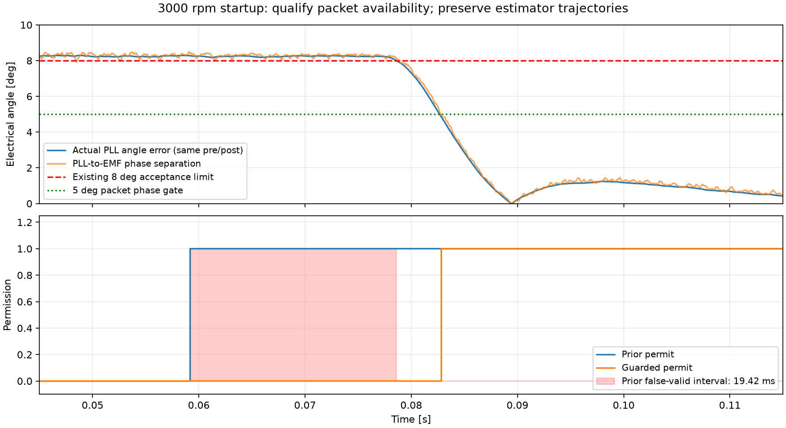

# N3R2后续：启动许可修正与五组稳态验证

2026-10-17。**五组正反转稳态工况通过，R2整体仍未完成，尚余9个动态/失配/故障工况及R3完整独立复现。** 本记录接续[前次编译诊断记录](N3R2.md)，不改判历史失败，不接管FOC反馈。

## 实际问题与修正

先按已冻结标准运行原R1估计链。3000rpm、0.8s工况成功计算，稳态精度达标，但启动有连续19.422375ms“许可打开而角差>8°”，超过2ms上限，因此判失败。独立CSV核验确认，该区间校正反电势角误差约−0.190°至+0.215°，PLL相对矢量却落后7.86°至8.49°；问题集中在许可条件，而不是需要调高SMO增益。

[实施前的瞬时许可设计](../contracts/nonideal_r2_phase_guard_design.json)先提交于`18e85e4`，实现提交`b6f9ced`。保留R1所有估计状态与原历史质量判断，另要求同次JEOS的PLL角与校正反电势矢量夹角≤5°、点积为正、幅值达到原关闭下限，并与采样/复位有效性相与。5°加3°模型误差预留对应原8°目标；3°是工程假设，不能宣称普遍真值上界。运行判断没有真实角度、速度或未来数据。新质量位仍到JEOS+3μs才发布。

瞬时模块放在原`有效判断`内部；九个根模块保持，新增2个作用域Goto，合计49个。Mask只读显示电角度门槛；新增8列诊断明确区分历史质量、瞬时夹角与数据包质量。见[代码与信号接口](../robust/phase_guard/INTERFACE.md)。

图显示0.045–0.115s，全部0–0.8s仍纳入误有效判定。原始角/速度估计没有被清零或藏掉，仅控制字段在拒绝时清零。[图来源](N3R2/followup_20261017/permission_comparison_provenance.json)。

3000rpm修正后，首次许可从59.181875ms推迟至82.831875ms，全程误有效从19.422375ms降为0，许可时最大实际角差4.84594°。这由相位条件决定，没有设置固定启动等待时间。对应19路完整估计轨迹、1,296,000个Time/Data数值与修正前严格`isequaln`；前端/SMO/PLL配置向量也完全一致，见[状态比较](N3R2/followup_20261017/v4_diagnostic_combined_3000_estimator_state_comparison.json)。

## 当前通过的五组工况

均为0.8s工程非理想组合，固定评价0.5–0.8s全部6000个JEOS样本，不按许可筛选。原生误有效覆盖整个运行，12,800,001个时刻逐点累计，状态事件独立重建一致。每个稳态窗口满足真实电机目标±1%、斜率≤50rpm/s、至少20电周期。

|目标[rpm]|角差RMS[°]|角差峰值[°]|速度误差RMS|稳态许可率|全程最长误有效[ms]|
|---:|---:|---:|---:|---:|---:|
|1000|0.0889|0.2428|0.6397%|100%|0.00|
|2000|0.0507|0.0982|0.0821%|100%|0.00|
|3000|0.0753|0.1179|0.0444%|100%|0.00|
|−1000|0.1278|0.2927|0.8380%|100%|0.00|
|−3000|0.0764|0.1131|0.0446%|100%|0.00|

阈值仍为角RMS≤3°/峰值≤8°、速度均值≤1%/RMS≤2%、许可≥99%、全程连续误有效≤2ms。五组许可违规及拒绝时控制字段未清零次数均为0。小稳态误差是这组固定工程假设和固定噪声种子下的结果，不能外推成实板精度。

20ms预检中，含原52路的81路共同日志、10,145,265个Time/Data数值仍与R1严格相同。完整记录及数据指纹见[来源汇总](N3R2/followup_20261017/summary.json)，其中`all_passed=false`明确表示R2整体未通过；五组通过不是完整矩阵验收。

相位组件覆盖572个角度/幅值/方向组合、3个质量/采样/复位否决、4个零值/非有限输入，并在1313个原生时刻验证原队列3μs发布因果性。组件成功不替代物理工况验证。

## 编译执行与记录边界

独立探针将原InitFcn原样移到停止状态执行，验证幂等，再暂时清空编译回调；编译前后工作区严格一致，配置与R1一致，撤层及恢复通过。该实质执行路径用于v3/v4，原SLX和R1冻结90文件保持。v3短工况仍一次原生异常、第二次完成；v4短工况、3000rpm及1000/2000/−1000首次完成，−3000首次在simulate阶段原生异常、唯一重试完成。全部尝试保留，未做第三次同版本尝试，根因仍未确认。

Windows转储只提取异常流及模块地址，不发布内存或会话信息。模块地址扫描不是符号展开的调用栈。停止初始化探针通过不能证明全局原生异常已修复。

原模型两路`obs_dead_gates`、`obs_dead_requested`本来只保留最后4000点；本次未修改其记录方式。最初覆盖检查误按无上限推算并失败，核实原SLX限制后，按原有保留策略检查52路时间网格均通过。初始检查源码留存，不能把这两路末尾约0.25ms说成全程门极记录。原生误有效统计和事件覆盖全程，不受这两路截断影响。R3原52路同配置长时基线回归仍未执行。

## 剩余工作

尚需2组本体R/L失配、动态变速/加载、2μs死区边界、ADC削顶、缺5帧、单次复位、低速/停转及调度抖动/超期，共9项。缺样/复位/调度适配不能仅靠当前瞬时相位许可代替；尤其还需验证故障识别后的第一原生监护调用撤销许可，以及物理恢复后的历史重建和重新锁定。

[R/L隔离设计](../contracts/nonideal_r2_plant_adapter_design.json)已在实现前提交`cf885bb`。配置组件证明：只把电机内部四个Fcn表达式中的Rs/Ld/Lq替换成独立本体符号，两组±20%失配均保持原名义参数，结构/工作区/SLX恢复通过。尚无R/L物理精度结果，不把配置检查当成失配达标。

最终仍需冻结完整候选，完成全矩阵后交用户验收，再进入R3独立完整复现与同配置原52路回归。3μs/5μs仍为工程预算，尚无实板WCET或闭环接管结论；旧N3缺项仍保留未通过。
