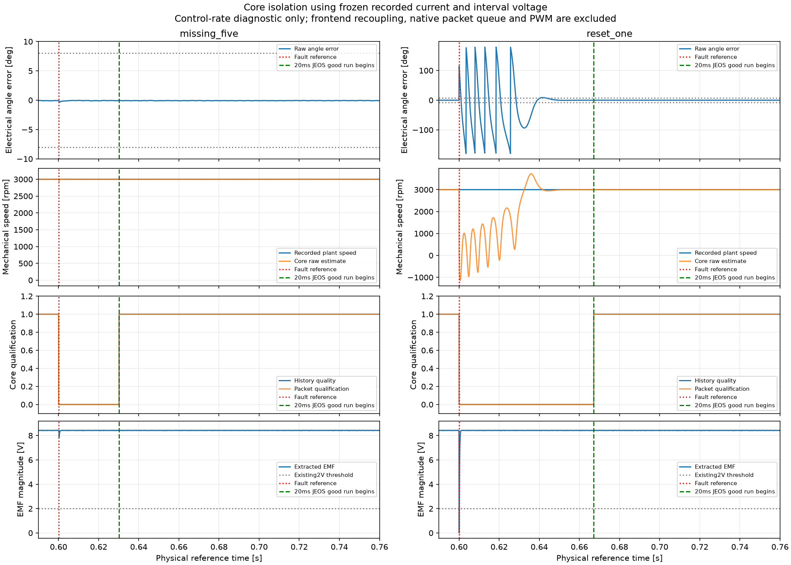

# R2 分层隔离诊断

2026-10-17 开始，2026-10-18 继续。**R2 仍未通过，原两项整模型故障验证未改判。** 原 v8/v9 已到上限的执行路径保持关闭；后续构造器更改单独预登记、先短检，再按自己的次数上限执行。SMO、PLL 和有效性参数保持。

## 已完成的隔离层

|层次|固定输入与标准|结果|
|---|---|---|
|纯函数核心|原 +3000 rpm 完整归档的 16000 个 JEOS 样本；自行推进 SMO、EMF、PLL、质量历史和上拍速度|18 路、496000 个数值与原归档完全一致，首次执行完成|
|纯函数故障核心|冻结同一段电流/区间电压，分别丢 5 个样本、复位 1 个样本|故障期不满足包级条件；没有早于 599 个健康采样机会重新满足条件；复位状态清零、丢样不做新电流校正|
|缩减 Simulink 核心图|使用原五个 MATLAB Function 包装脚本、原参数和自身 Unit Delay；29 个作用域 Goto；50 μs 节拍|正常、丢样、复位三个图分别与纯函数的 18 路、496000 个数值完全一致|
|原生评价器与启用式日志|62.5 ns 步长、0.8 s；保留原评价/事件记录器，用独立整数节拍刺激|12800001 次评价、16001 个计数样本、32004 条事件均符合独立计算，首次执行完成|
|不装观测层的原主模型对照|同一工程非理想配置，0.8 s；原 52 路保留；仅一次有效执行|12800001 主步完成，52 路 Data/类型/尺寸严格一致，恢复通过|

纯函数基础回放耗时 0.567 s；缩减 Simulink 三图各约 8.8–8.9 s；原生日志诊断 12.32 s。这些是本机诊断耗时，**不是 MCU WCET**。

原生日志诊断故意制造了 **2.0000625 ms** 的超限区间，即 2 ms 多一个原生节拍；评价器准确报告 32001 个节拍，没有被按 2 ms 四舍五入。其许可时长 0.7497 s，许可违规、低速许可和拒绝时非零控制值均为 0。这里的“通过”是诊断预期值准确，不是把这个故意超限的刺激判为算法达标。

## 核心恢复结果的含义

|冻结输入的核心诊断|健康样本恢复后，开始连续 20 ms JEOS 好状态的延迟|包级合格但超出角度/速度参考界限的 JEOS 数|
|---|---:|---:|
|缺 5 帧|29.9 ms|0|
|软件复位 1 帧|67.1 ms|0|

软件复位后原始速度先出现负值、振荡和超调，角度也暂时失锁；包级条件在这段时间保持不满足。图中没有平滑、隐藏或改写这些原始估计。

电压输入冻结在健康观测器的原轨迹，因此这里**不覆盖**丢样/复位对电压预测器、采样前端及其反馈历史的再次影响；也未运行原生发布队列、CCR 截止期或整模型监督器。图中绿色标记表示 JEOS 核心条件连续保持 20 ms 的起点，不能当作原生许可恢复时间。

## 失败记录及证据边界

缩减模型构建保留三个执行前脚本/配置错误：保存名称导致加载模型改名、禁止插值与默认外推配置冲突、结构体无时间格式缺少空 `time` 字段。都未执行采样。修正模型文件同名保存、显式保持末值及空 `time=[]` 的逐样本输入格式后，才进行首次有效正常计算；没有数值失败后重跑选优。输入格式依据 [From Workspace 官方说明](https://www.mathworks.com/help/simulink/slref/fromworkspace.html)，所有 16000 点及原数值保持。

原主模型对照首次还保留一个初始化前的命名参数书写错误：未将 StopTime 作为命名参数传递。修正后使用独立目录，原失败报告和源码仍在。

本轮进程中未发现 `startup.m`，9 个纯核心函数的实际路径和源码指纹均已核对；没有据此断言用户所有环境都不存在问题，也没有重置用户路径或偏好。

已完成的缩减测试没有复现崩溃；它们支持把后续排查集中到尚未覆盖的主图集成路径，但不足以排除间歇性环境问题或确认根因。原主模型对照已完成 405.48 s 本机计算，原 52 路 Data、类型、尺寸及整数节拍完全一致；两路门极 Time 仅编码差 1.11e−16 s，符合已登记格式规则。它是开发对照，不是最终 R3 验收。

2026-10-18 继续检查调用链，发现原构造器查询尺寸前的 compile/term，以及固定参考 restore 的 update，都会在装观测层前编译原模型。首次尺寸审计也包含参考更新和一次端口查询编译，共两次；原报告保留，其 compile_original_once 阶段名仅指查询那次。修正后的独立审计只显式编译一次，实际三组尺寸、类型、源 SID/端口与首次测量完全一致。

已生成按冻结源码精确推导的新构造器和不触发 update 的参考恢复适配器，不改原冻结源码或任何算法方程。实测生效 CCR 是 3 元向量，测量电流/ADC 均为 3×1。新接入短检完整 96 路、10,203,729 个数值严格一致，原图/工作区恢复通过。缺帧两次仍因 0xc0000005 / 0xc000001d 中断，最后保存进度分别 0.12 / 0.57 s，均在故障注入前；已停止该版本缺帧执行。复位任务仍在按登记上限运行。接入修改不足以解决稳定性问题，不能宣称根因已确认。

原生发布队列的独立缩减诊断已先登记标准、完成代码静态检查；等待整模型任务结束后执行。它将单独核对逐拍输出、五帧丢失、复位、抖动及精确发布时刻，不替代整模型验收。

系统提交内存快照约 47.6/59.6 GB，未找到与 56 条既有本任务记录匹配的存活 MATLAB 进程；未终止用户 GUI 或任何归属不明进程，也未把快照解释为内存耗尽证据。

另一次只读 Windows 查询发现 2026-10-17 12:49:57 的 WHEA19：处理器核心报告 Corrected Machine Check / Translation Lookaside Buffer Error。该事件前后两分钟未查到 Application1000 记录。本机型号为 i9-14900HX；**这不是 CPU 损坏或 MATLAB 崩溃因果关系的结论**，只增加一个应保留的主机稳定性线索，未修改系统设置。[本机记录](N3R2/isolation_20261017/host_observation_20261018.json)；WHEA 的事件记录含义见 [Microsoft 官方说明](https://learn.microsoft.com/en-us/windows-hardware/drivers/whea/whea-hardware-error-events)。

[指纹与全部成功/失败记录](N3R2/isolation_20261017/summary.json)。原始 MAT、生成的缩减 SLX、私有环境和控制台留在本地 runs；Git 保存标准、代码、脱敏报告和图片。原 SLX、R1 冻结 90 文件保持。
