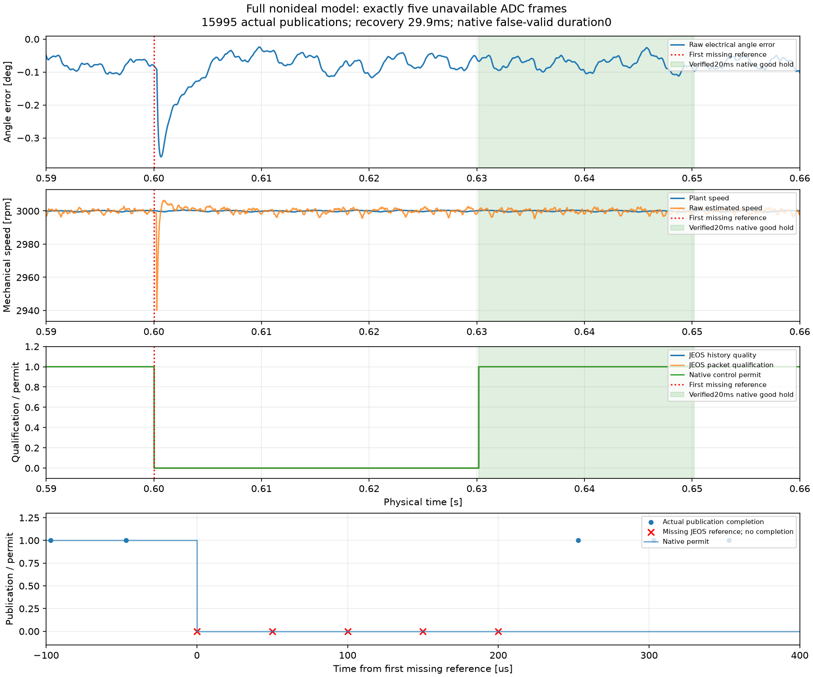

# R2 观测输入缺 5 帧的整模型验证

2026-10-18。开发验证及随后冻结候选的首次正式缺帧执行均通过；正式矩阵在下一项初始化异常后停止，**R2 节点未通过**。

工程非理想配置下运行 0.8 s，62.5 ns 原生网格共 12800001 次评价。0.600028875 s 起连续缺失 5 个观测输入包，覆盖 250 μs；实际归档 15995 个发布包。主控制仍使用原反馈，因此该试验检验观测输入链路丢帧，不代表整机 ADC 故障保护已接入。

|预先规定的检查|结果|
|---|---|
|缺失数量及参考/实际完成时刻|恰好 5 帧，通过|
|首原生拍撤销许可|通过|
|恢复前至少 599 个健康采样机会|通过|
|150 ms 内恢复且原生连续保持 20 ms|健康输入恢复后 29.9 ms 开始合格区间，通过|
|全程最长误放行|0|
|许可违规、拒绝时非零控制值|均为 0|
|原图、回调、工作区和固定参考还原|全部通过|

图来自开发阶段已保存数据，未重新仿真、平滑或重采样。红叉为 5 个缺失参考时刻，圆点为实际发布完成时刻；绿色带为原生层已验证的连续 20 ms 合格区间。原始估计在本次短暂缺帧中扰动较小，仍必须撤销许可并完成重新资格判定。

开发引用适配路径第一次在约 0.25 s 留下最后进度后原生中断，按当时规则允许的第二次尝试完整通过；两次记录都保留。开发原始数据 SHA256：`ae13e3a8f4953d0bc11765f7bce709e58c1d79b97488217cd077558cfda1b3ff`。

冻结正式候选的缺帧项仅启动一次，完整通过，原始数据 SHA256：`37120d0ad85f9c3b40c637e25a45c1af1362bcfa0961cd97e5804c5d42fc20c8`。正式与开发的恢复时间均为 29.9 ms，分别保存数据与来源，未把开发结果补入正式矩阵。

[正式节点执行记录](N3R2_formal.md)；[开发指标](N3R2/development_20261017/N3R2_reference_missing_five_20261018_102118_81346694-c8d6-4b4d-8bd4-6d623516a408/missing_five_attempt_2/metrics.json)。
