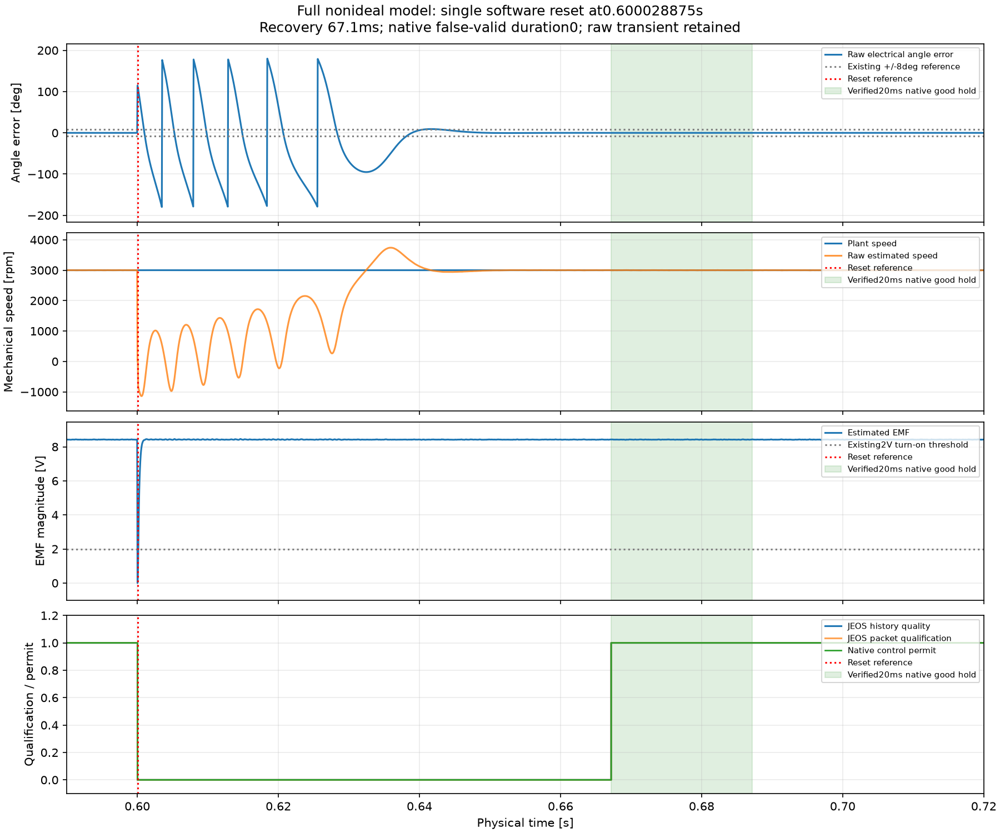

# R2 观测器单次软件复位的整模型验证

2026-10-18。该项开发验证通过，**R2 全节点尚未通过**。

在原主模型的工程非理想配置下运行 0.8 s，62.5 ns 原生网格共 12800001 次评价，保存 16000 个 JEOS 样本、16000 个实际完成包、32005 条原生事件。0.600028875 s 注入一次 50 μs 观测器软件复位；本次新构造器首次执行完成，没有重跑选优。原模型、电机名义参数、SMO/PLL 方程和验收阈值保持。主控制继续使用原反馈，本项不模拟 MCU 或整套控制器复位。

|预先规定的检查|结果|
|---|---|
|首个原生调用撤销控制许可|通过，复位原因位生效|
|禁止提前重新许可|通过，满足至少 599 个健康采样机会|
|恢复限时及连续保持|健康参考恢复后 67.1 ms 开始合格区间，原生层连续保持 20 ms，低于 150 ms 上限|
|全程误有效|0，原生计数与独立事件积分相符|
|许可违规、拒绝时非零控制值|均为 0|
|原图、回调、工作区、固定参考及源文件恢复|全部通过|
|归档格式适配|通过；仅按既定规则规范两路门极时间编码，原始归档未修改|

复位后未合格的原始估计确实失锁：角误差峰值 179.991°，原始速度约 −1140.32 至 3740.11 rpm。此时许可关闭。全程已许可时刻的最大角误差 4.84594°，已许可速度相对误差最大 1.07701%。保留全部原始估计，没有平滑、裁掉异常或只统计有效样本。

图的横轴展示复位附近区间；所有验收计数覆盖完整 0–0.8 s。绿色带对应已验证的原生 20 ms 合格保持区间。原始速度是观测器输出，电机实际速度保持约 3000 rpm；观测器仍未接管反馈。

原始数据 SHA256：`b5a7cb1b8a3136c14d45c9ccce857c55ee8d808f94c6224cee2cc2e1db639180`。本机计算耗时约 473.14 s，不代表 MCU 执行耗时。

[完整指标](N3R2/development_20261017/N3R2_constructor_reset_one_20261018_093152_cb5137d5-677c-4502-ba18-5a3d529f78f0/reset_one_attempt_1/metrics.json)；[源码、配置与恢复记录](N3R2/development_20261017/N3R2_constructor_reset_one_20261018_093152_cb5137d5-677c-4502-ba18-5a3d529f78f0/reset_one_attempt_1/record.json)。随后引用适配器已补齐[连续缺 5 帧](N3R2_missing_recovery.md)完整证据。冻结正式矩阵在缺帧项通过后，因下一项初始化原生异常停止，见[正式记录](N3R2_formal.md)；本项旧开发结果不能替代该矩阵中的复位项。R3 尚未进行。
