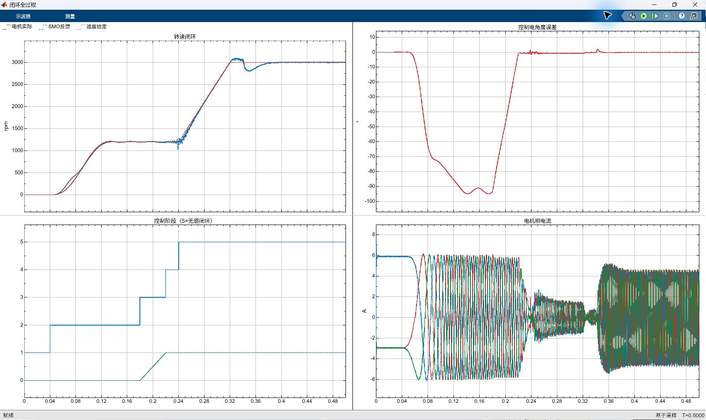
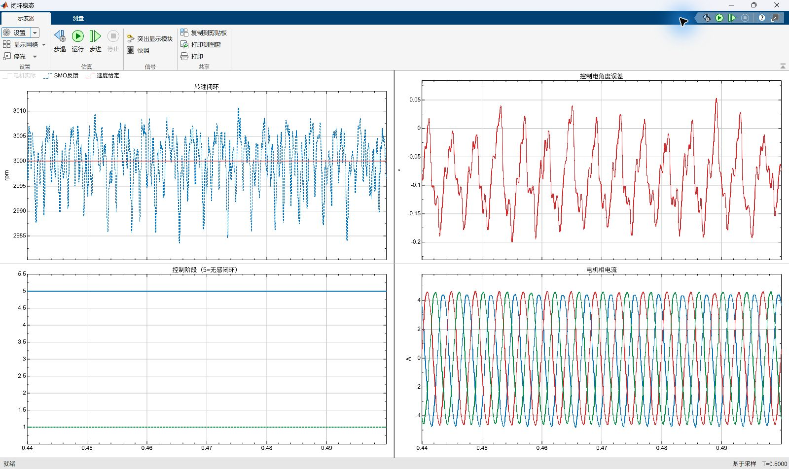

# SMO 本地无感闭环节点（2026-10-19）

状态：适配后首轮完成并通过全部预定指标；同一候选的独立复跑正在执行，尚未完成本节点的两轮验收。

模型为 [PMSM_SMO_ClosedLoop.slx](../models/closed_loop/PMSM_SMO_ClosedLoop.slx)，入口为 [closed_loop](../closed_loop/README.md)。控制结构是对齐 → I/F 起动 → 角度平滑切换 → 起动 Id 退出 → SMO 速度闭环。正 Park、反 Park、交叉解耦和速度 PI 实际使用选定的估计角/速度；起动、许可资格与切换不使用真实转子量。真实角度/速度只在观测区用于对照。

实施前的 [acceptance.json](SMO_closed/acceptance.json) 在提交 `5376602` 中已登记，调参时没有修改：0.50 s、3000 rpm、0.34 s 加 0.207 N·m 机械负载，固定稳态窗口 0.412–0.50 s；要求 0.30 s 前完成接管、稳态保持阶段 5、至少 20 电周期、速度/角误差与电流满足限值，并有两次独立成功运行。

首轮新运行 `SMO_closed_adapted`：MATLAB PID 22940，仿真执行 417.18 s，实际轨迹阶段为 1 → 2 → 3 → 4 → 5；0.240078875 s 完成接管，负载后保持阶段 5、估计权重 1、有效估计比例 100%。[报告](SMO_closed/first_report.json)、[完整指标](SMO_closed/first_metrics.json)。

|指标|首轮结果|事先标准|
|---|---:|---:|
|速度对给定平均偏差|0.00231%|≤1%|
|速度对给定 RMS 误差|0.01784%（0.535 rpm）|≤2%|
|观测转速 RMS 误差|0.16715%（5.014 rpm）|≤2%|
|控制角/观测角 RMS 误差|0.10217°|≤3°|
|控制角/观测角峰值误差|0.20873°|≤8°|
|全过程采样相电流峰值|7.295 A|≤10 A|
|实际转速峰值|3080.81 rpm（2.69%）|≤3300 rpm|
|稳态电周期|21.9879|≥20|

切换期间定子电流给定矢量的最大相邻步进为 0.18849 A，符合 6 A 矢量以 1200 rpm、5 极对、50 μs 自然旋转的步进 `2·6·sin(ωe·Ts/2)`；没有整段坐标切换造成的给定跳变。速度 PI 积分先跟踪起动电流，再闭合速度调节。

保留 ADC/量化/滤波、死区/器件压降、50 μs 控制周期和 3 μs 延后发布。PLL 按本地启动和负载加速度需求从旁路版本的 60 Hz 适配为 150 Hz，起动电流转向与 I/F 频率采用两端平滑的曲线，见 [动态设计和首轮失败定位](../closed_loop/DESIGN.md)。原主模型和已通过的旁路模型保留。

以下两张是 PID 22940 实际运行结束后的原生 Simulink Scope 窗口截图，未经改绘，没有向 Scope 回灌归档数据。[截图来源记录](SMO_closed/native_capture.json)。指标仍使用完整的预登记 88 ms 窗口；第二张为 0.44–0.50 s 的 60 ms 稳态局部展示。

全过程图的起动段，控制角相对转子约 −90° 属于 I/F 坐标系；0.18 s 开始切换后误差收敛。图例「SMO反馈」在起动段实际显示控制器使用的 I/F 内部速度，估计角权重达到 1 后完全来自 SMO。

首个开发候选 `nominal` 未通过，未计入成功轮次，完整轨迹保留本地；其[失败指标](SMO_closed/initial_failed_metrics.json)、[报告](SMO_closed/initial_failed_report.json)、[定位数据](SMO_closed/initial_failed_diagnostics.json)保留。另一次首次编译的 Scope 分相维度错误已修复，没有物理仿真轨迹，不能计作成功或用新结果覆盖。

当前范围是工程假设下这一启动和正转带载工况的仿真闭环。实板采样/运算耗时、参数失配、反转和全速域性能尚未据此验证，不把本节点当作实板或全工况达标。
