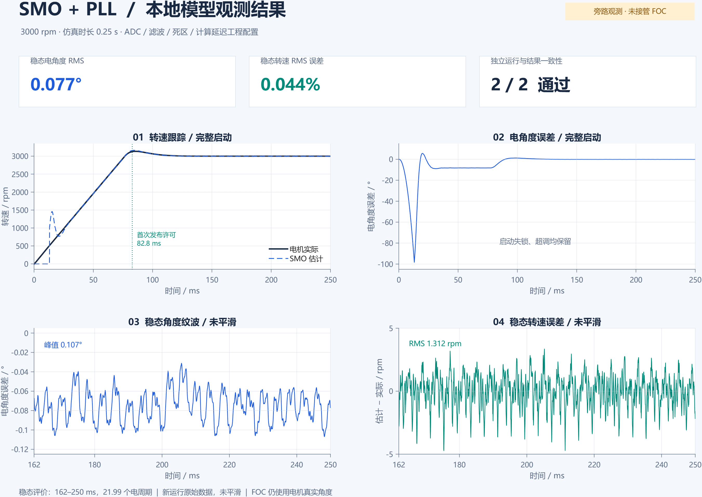
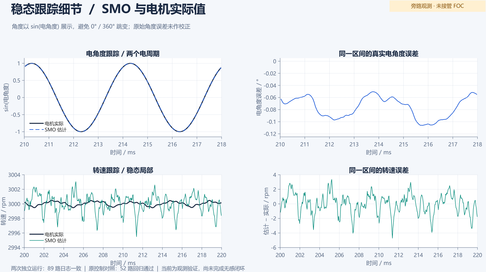

# 主模型直接接入 SMO：正常工况复现通过

2026-10-19。3000 rpm、0.25 s 的正常非理想工况已完成两次独立 MATLAB 运行，稳态指标通过，全部 89 路日志复跑一致；相同时长的原控制对照中，52 路日志回归通过。

工作模型：[PMSM_FOC_R2026a.slx](../models/direct/PMSM_FOC_R2026a.slx)。采用主模型内直接连接的观测子系统，505 个内部模块、49 个作用域 Goto。没有引用模型、高频真值评价器或故障刺激。SMO/PLL 复用现有数学核心，保留实际 ADC 顺序采样、量化、标定/噪声/滤波、死区/压降、因果电压重构、50 μs 观测周期及 3 μs 模拟发布延迟。普通 Scope 与观测日志按控制周期记录，实际完成的数据包另行记录。

**当前通过的是旁路观测验证。现有 FOC 仍使用电机真实角度反馈；SMO 估计角度尚未接管 FOC，无感闭环尚未完成。**

|固定稳态窗口 0.162–0.25 s|两次结果相同|事先标准|
|---|---:|---:|
|电角度 RMS|0.076944°|≤3°|
|电角度峰值|0.106945°|≤8°|
|转速均值误差|0.000511%|≤1%|
|转速 RMS 误差|0.043724%|≤2%|
|实际转速均值|2999.9836 rpm|目标偏差 ≤1%|
|实际转速斜率|0.7692 rpm/s|绝对值 ≤50 rpm/s|
|电周期数|21.9873|≥20|
|完成事件许可占比|100%|≥99%|

每次均有完整 5000 个观测样本和 5000 个完成数据包，序号/参考时间连续，模拟完成延迟为 3 μs。启动段未裁剪，首次失锁与速度超调保留，稳态纹波也保留。这里的延迟、器件和 ADC 参数仍为已获用户授权的工程假设；当前交付是旁路观测。

新版图仅重绘本次已保存数据，没有加载模型或重新仿真，保留全部启动过程和稳态原始纹波。[总览矢量 PDF](SMO_direct/review_overview.pdf)、[细节矢量 PDF](SMO_direct/review_detail.pdf)、[绘图数据 CSV](SMO_direct/review_data.csv)、[数据与绘图来源](SMO_direct/review_source.json)。

## 执行与证据

- 首次实际 PID 65848，仿真耗时 185.75 s，正常结束，退出码 0；[稳态指标](SMO_direct/first_metrics.json)。
- 独立复跑实际 PID 67644，仿真耗时 175.72 s，正常结束，退出码 0；[复跑结果](SMO_direct/repeat_report.json)、[89 路比较](SMO_direct/repeat_comparison.json)。保存模型及参数未变。
- 仅移除观测层及两个外部测量抽头的原控制对照，PID 47660，0.25 s，正常结束；[52 路比较](SMO_direct/first_original52_equal_duration.json)。
- [汇总](SMO_direct/summary.json)、[事先标准](../direct/acceptance.json)、[参数与模型生成记录](../models/direct/build.json)、[打开及运行入口](../direct/README.md)。原始 MAT 保留本地 `runs/SMO_direct_*`，Git 保存结果与指纹。

首次后处理曾误用旧 0.8 s 归档比较两路仅保留最后 4000 个点的门极记录，旧记录在 0.25 s 之前已无数据，因此原报告总判定为 false；其余 50 路与收敛指标通过。这不是两路门极数值失配证据。原[报告](SMO_direct/first_report.json)和[时间段检查](SMO_direct/gate_prefix_inspection.json)保留，未覆写。补充相同 0.25 s 原控制对照后，52 路全部通过；[只读复核](SMO_direct/first_review.json)没有重跑首次 SMO 仿真。

生成模型前，新安装目录的一次 MATLAB 启动在进入构建函数前发生 `0xc0000374`，未生成模型或执行仿真；[启动失败记录](SMO_direct/initial_clean_build_startup_failure.json)保留。随后使用日常安装的常规入口完成构建和上述全部运行。本节点结果不宣称已经解释所有历史原生异常的根因。

按用户要求，旧故障矩阵及额外平台不再继续。此前结果保留为历史记录。本节点交用户验收，不自动接管 FOC 或加入其他算法。
