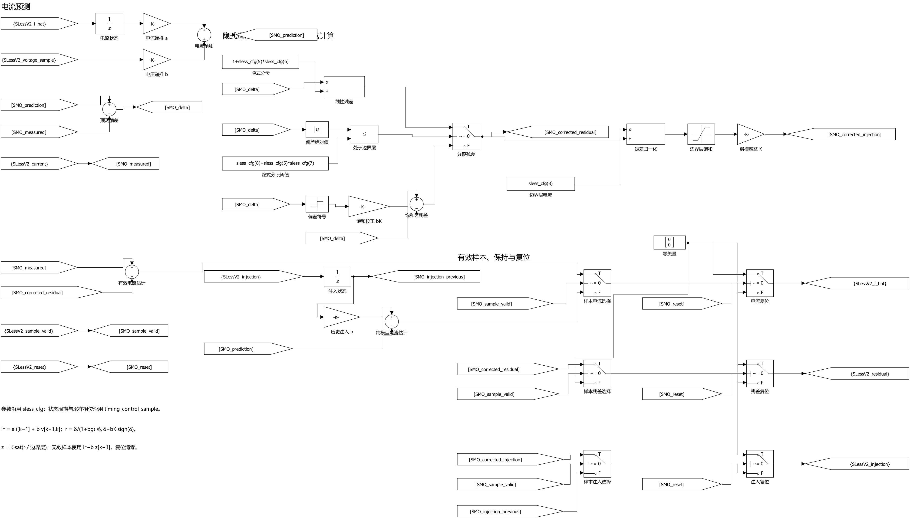

# 仅将滑模计算展开为原生块

按用户纠正的范围，撤回 `7eaa60e` 中的全模型布局、反电势与 PLL 展开，回到 `9ca4d2b` 的已验收闭环模型。此次只改 `无感观测/滑模观测` 内部，直接使用原生 Gain、Sum、Unit Delay、Abs、Sign、Relational Operator、Switch、Divide、Saturation、Constant、Goto/From，不新增自定义子系统或掩码。

实施前的标准在 `closed_loop/native_smo_acceptance.json`。本页以外的模块、位置、参数、掩码、连接、脚本及模型求解配置需与原版一致；核心逐样本核对实际 10000 个采样点及复位、无效样本分支；完整闭环复用原 0.50 s 工况和验收门槛，并比较全部 100 路日志。

参数继续由原初始化根据电机和观测器设置计算，通过已有 `sless_cfg` 使用。两处电流/注入历史状态继续使用原 `timing_control_sample`，保留采样相位、隐式分段解、无效样本纯模型预测和复位清零。PLL、反电势处理、采样、发布及启动切换均使用原来的实现。

当前状态：本节点完成，等待用户验收。工作模型为 `models/closed_loop/PMSM_SMO_ClosedLoop.slx`，打开后进入 `无感观测 → 滑模观测` 即可查看；MATLAB 已停在该页。

核对结果：

- 滑模内部共 64 个原生基础块，无新增子系统、掩码或 MATLAB Function。两处 Unit Delay 均使用原 `timing_control_sample` 和 `[0;0]` 初值。
- 本页以外的模块、位置、参数、掩码、连接、脚本和求解配置全部与 `9ca4d2b` 一致。原主模型及旁路基线文件指纹不变。
- 核心与原代码逐拍比较：实际 10000 个采样点，以及另行检查的 1000 个样本（含 3 次复位、165 个无效样本），电流估计、残差、滑模注入三路输出的时刻、维度及数值完全一致，最大差值为 0。
- 新运行 `SMO_closed_native_smo_a` 完成 0.50 s 无感闭环，约 0.240079 s 接管，0.34 s 加载 0.207 N·m，最后 88 ms 保持阶段 5。转速 RMS 相对误差为 0.017842%，观测角 RMS 误差为 0.102168°，相电流峰值为 7.295424 A，原闭环标准全部通过。
- 对原闭环归档比较全部 100 路日志：名称、原始维度、采样时刻和数值完全一致。本次仅启动一次物理仿真，本机墙钟耗时 757.5 s；原版同工况归档耗时为 427.5 s。

交付模型与此次实际执行文件 SHA-256 均为 `7c2d416f94266497bd796868a0fa92a7bd8573bf9435e79eafdd544aa3a629a8`。结果来自本次真实运行，原始 `signals.mat` 保留在本地 `runs/SMO_closed_native_smo_a/`。

标准、范围检查、核心核对、结构检查、闭环指标及全部 100 路比较见 [SMO_native/](SMO_native/)。以下为该模型滑模页的原生 Simulink 导出图，未另绘或编辑图片：

