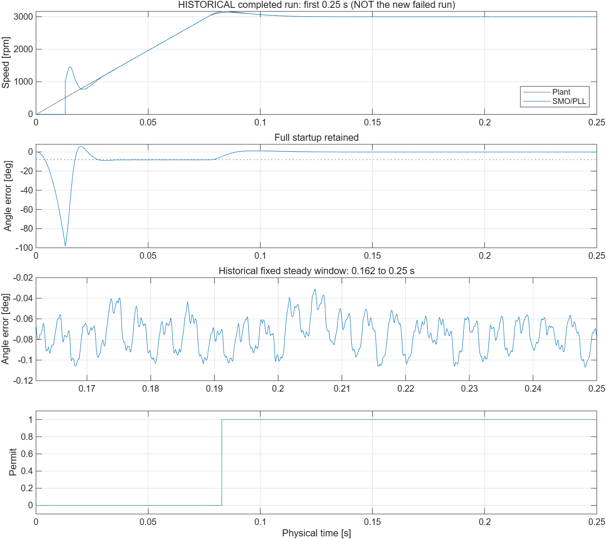

# SMO 短时收敛验证

2026-10-19。按用户意见，正常工况改用足以覆盖收敛及稳态评价的短时长。先用已有完整轨迹确定窗口，再登记一次新运行；不降低误差标准，不反复缩时寻找成功结果。

历史归档的只读分析支持：+3000、+2000 rpm 使用 0.25 s；+1000 rpm 使用 0.35 s。均要求稳态窗口至少覆盖 20 个电周期。它们是选取时长的依据，不能代替当前模型重新执行通过。

本次预登记并执行的只有 +3000 rpm：总时长 0.25 s，固定评价窗口 0.162–0.25 s。角度 RMS ≤3°、峰值 ≤8°，转速均值误差 ≤1%、RMS ≤2%，许可占比 ≥99%，实际转速斜率绝对值 ≤50 rpm/s，误放行连续时长 ≤2 ms。保留工程假设下的 ADC、死区、采样及发布延迟；SMO/PLL、电机、PI、求解器与步长不变。本项不包含注入故障或反馈接管。

**新运行未通过。** 实际 MATLAB PID 59320，完成加载、86 参数核对、结构与备份检查、Normal 编译后，在一次 sim 调用中原生退出 `0xc0000005`。没有完整 signals.mat 或可计算的新性能指标，物理仿真进度未知，执行器后续恢复未执行；零重试，当前无后台仿真。缩短时长未解决此执行问题，不能据此归因于 SMO 参数或电脑硬件。

- [预登记协议](../contracts/short_convergence_20261019.json)
- [执行结果与边界](convergence_short_20261019/summary.json)
- [实际运行阶段](convergence_short_20261019/execution_report.json)
- [历史窗口分析](convergence_short_20261019/historical_window_analysis.json)

下图仅来自以前完整完成的 +3000 rpm 轨迹，保留了启动过程，不能作为本次失败运行的波形。历史稳态窗口角度 RMS 0.07694°、峰值 0.10695°，转速 RMS 误差 0.04372%，许可占比 100%，覆盖约 21.99 电周期。

[图片及 CSV 来源指纹](convergence_short_20261019/history/historical_figure_provenance.json)。历史原始 MAT 保留本地，未提交。

后续定位重点收窄到主模型适配和记录链路。可以单独检查仅用于真值评价的原生计数/事件记录模块，保留真实采样节拍、非理想前端、SMO/PLL 和发布保护。尚未实施该结构隔离，也未安排新的物理运行；若实施，需另行固定边界和终点检查，不能计入已关闭的 R2 批次。R2 仍未通过，R3 与反馈接管未开始。
