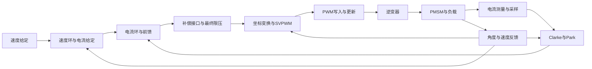

# PMSM 仿真框架与开发基线

2026-10-12按用户最新方向整理。当前任务是完善框架、开关和可复现基线；暂停补偿算法优化、PI整定和器件细节扩展，布局与理线后续统一处理。

本说明最初是现有代码、参数档案和验证记录的审阅结果。随后已开展第一步固定参考与开关规则开发，操作与验收范围见[固定参考与开关](README_固定参考与开关.md)，实际检查结果以`reference_validation.json`为准。主模型未修改；历史专项验证仍不能自动视为同一最新版的完整验收。

## 两个用途，共用一个模型

- 教学：从固定参考出发，只开启指定因素，允许放大该因素；对照真值、测量值、控制输出和结果。
- 算法提前验证：逐步组合经过校准的因素，在相同工况下替换控制算法，评估性能与边界。当前仍有演示参数，尚不等同于实物控制器。

教学参数、固件推定参数和实测参数必须分别标明。放大死区的教学实验不能作为实板精度证明。

## 整体信号链

这张图表示功能连接，不表示重新封装小模块。时序层决定采样、计算及输出生效时刻；观测层在各段入口和出口取信号；参数层负责配置与来源记录。

## 已有内容与当前边界

| 部分 | 已有内容 | 当前边界 |
| --- | --- | --- |
| 控制链 | 速度/电流PI、dq前馈、最终电压圆限幅与抗饱和、SVPWM | PI为Backward Euler实现，尚非固件PDFF或位级等价；动态未按实板整定 |
| 被控对象 | PMSM数学模型、沉沙200W标称电参、惯量/摩擦/负载参数 | 标称参数不等于实测；详细桥近零模型当前要求Ld=Lq |
| 时序 | PWM/CCR预装载与更新、顺序ADC、JEOS计算、速度分频、有效窗口 | 部分时刻为推定或演示；不含完整CPU调度及跨周期中断排队 |
| 测量 | 电流偏置/增益/噪声、模拟/数字低通、ADC量化、角度误差；可逆编码器计数/角度读取/历史延迟扩展；三窗口计数测速、速度反馈选择及独立速度低通 | 第十六项20kHz滤波/10kHz速度PI，200Hz为源码参考；缺样处理、ABZ电气边沿及启动对齐待开发，默认固定参考仍走原速度 |
| 功率级 | 门极死区、二极管续流、器件压降、基础极性补偿 | 近零续流含数值近似；补偿不是所有工况都改善；母线仍为常值来源 |
| 操作与观测 | 参数窗口、JSON、来源/校准记录、分组观测；固定参考恢复与依赖预检；十六项固定实验与逐次档案、复跑比较及独立展示文字 | 原六项与后续专项证据分别保存，编码器/测速/反馈/速度滤波字段另存实验计划/记录，未写回原62项参考档案；其他因素及组合工况继续逐批补充 |
| 状态与保护 | 已有电流指令限幅 | 指令限幅不等于过流保护；完整启动/故障状态与主动保护链待开发 |

因此当前可作为教学与算法研究的工作版本；“实板适配完成”的基线尚未建立。

## 现有开关及规则

参数档案目前含62项设置，其中19项为开关。数量包括策略和运行模式开关，不代表19种物理误差。以下按所属设置区区分同名键。

| 设置区 | 现有开关 |
| --- | --- |
| 时序 | 速度分频、整周期输出延迟、真实时序、低侧采样窗口、无效样本保持 |
| 电流采样 | 零偏、增益误差、噪声、ADC量化与饱和、数字低通、整周期采样延迟、模拟低通 |
| 角度 | 偏置、量化、延迟 |
| 功率 | 旧平均死区压降、器件导通压降、门极死区、死区补偿 |

已有代码约束：真实时序与旧整周期输出/采样延迟互斥；低侧窗口依赖真实时序，无效值保持依赖窗口；门极死区与旧平均死区互斥；补偿依赖门极死区。

“全关参考”指上述非理想/教学开关关闭，不关闭必要控制功能。dq解耦默认开启，属于控制算法选择。随机种子、求解网格、近零数值带属于复现或数值设置，应与硬件误差分开解释。

每项开关后续统一说明：作用位置、关闭时的信号路径、开启时的模型、幅值与单位、来源及校准状态、依赖关系、配套观测。不是所有设置都能任意组合。

## 现有预设的准确含义

`pmsm_config('preset',...)`在当前配置上调整开关及部分死区参数，保留其他参数；它是预设模板，不保证恢复同一组完整初始条件。

- `reference`：关闭上述开关，保留当前其他参数。
- `teaching`：开启真实时序及门极死区，死区/补偿时间设为2μs；补偿默认关闭。
- `board`：开启真实时序及门极死区，死区/补偿时间设为0.5μs；补偿默认关闭，是未校准的实板参考。

后续固定实验应加载保存的完整配置，记录工况、控制器参数、初始条件和运行选项，不能只记录预设名称。

第一版固定参考入口为`pmsm_reference('restore')`，参数窗口对应“恢复固定参考（整套）”。它与上述局部预设分开，包含工作区、PI、初态、给定/负载、日志和运行设置；检测到模型或脚本版本变化时拒绝混用。具体操作见[固定参考与开关](README_固定参考与开关.md)。

第二轮已完成[固定单因素实验第一批](README_固定单因素实验.md)：电流零偏、采样噪声、整拍采样延迟；独立入口`open_pmsm_experiments`，统一两页波形和逐次存档。实验运行后恢复参考，第一版参考档案与工具保持原样。作用关系、复现和操作检查见`experiment_validation.json`。

## 下一阶段：先收束框架

| 顺序 | 工作 | 完成标准 |
| --- | --- | --- |
| 1 | 冻结参考配置与清单 | 绑定主模型指纹、完整参数、PI、初值、求解设置、随机种子和脚本版本；区分已知、演示和待实测 |
| 2 | 统一开关契约和操作 | 明确旁路行为与依赖；保存/恢复完整配置；错误组合提示清楚；教学与实板参考命名无歧义 |
| 3 | 建立固定场景和共同观测 | 理想参考、单因素、因素组合使用同一比较方式；至少包含启动、稳态和负载变化；死区实验保留理想/死区/补偿三组 |
| 4 | 形成基线验收与发布记录 | 同一版本检查关闭回归、开启行为、依赖约束、保存重载和重复运行；结果包保存完整配置与版本，避免缓存覆盖冒充基线 |
| 5 | 预留算法及未建模链路接口 | 约定测量、补偿、调制、状态/保护等接口的单位、方向、采样时刻和限幅责任；未实现功能明确标记，不做空开关 |

验收先关注运行正确、信号含义一致、开关影响可解释、结果可重复。基础补偿效果有限可以保留为已知边界，不以某一算法性能最优作为框架成立条件。每轮只增加一个可解释、可验收的能力，先带读再进入下一轮。

后续算法资料再按厂商文档、原始方法与可复现验证交叉核对；当前不根据某篇论文继续增加补偿方法。

## 当前版本身份

- 主文件：`../PMSM_FOC_R2026a.slx`。
- 本轮静态确认SHA-256：`a0f7cbae9e7c334c25aa9dcf6e7e88d65fd89bd1888a0fa2ec0cd04f6cce262d`。
- GitHub已上传的是更早真实时序基线，main提交`2cf781b`；本地后续死区及参数工作尚未统一提交。
- 补偿展开候选仍是`verified_candidate`，未替换主文件，布局工作继续后移。
- 参数窗口历史验证见`parameter_settings_results.json`；其余专项记录见主README。下一阶段需绑定同一冻结版本重新形成验收证据。
