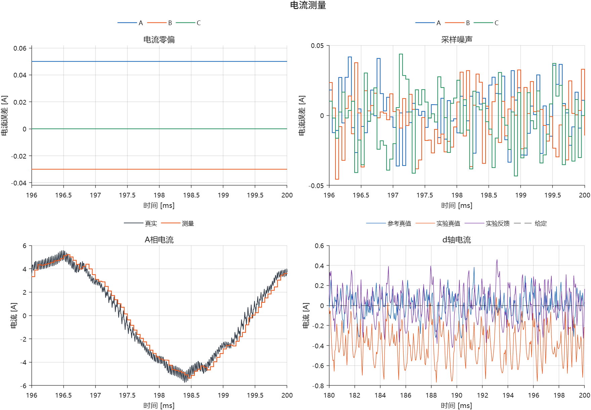

# 测量链三项带读

本轮读取已经完成并通过档案校验的三组实验，不重新仿真，不改模型、PI、开关默认值或固定参考。图中因素参数均为演示值。



## 先沿着反馈线看

电机真实三相电流 → 采样设置 → Clarke/Park → dq电流反馈 → 电流PI与前馈 → 限压、调制、逆变器 → 电机。

“真实电流”供我们核对物理状态；控制器实际使用的是测量链输出。开关位于反馈路径，改变测量以后，PI会改变电压，因此也会间接改变真实电流。不能把测量误差和电机电流变化当成同一个量。

## 1. 零偏：总是看错一点

此实验只有零偏开启：ABC分别加0.05、−0.03、0 A。左上是同一实验内“测量值减同时刻真值”，所以得到三条水平线。

PI调节的是经过Clarke/Park后的反馈值。ABC中固定的偏置经过旋转变换后，一般不再是固定的dq偏置，而会成为周期性分量。因此不要把三相零偏直接等同于一个固定的id或iq误差。

未来与实板对应的是采样放大器/ADC零点校准。当前只用电流域等效偏置，不表示已完整模拟前端电路。

## 2. 噪声：每拍看错的量不同

此实验每相注入0.02 A RMS采样噪声，固定随机种子。右上仍然画“测量值减真值”；误差围绕零变化。末20ms实际误差RMS约0.019 A，有限样本不必恰好等于设定的0.020 A。

噪声经坐标变换进入电流误差，PI随之改变电压指令，可能进一步影响真实电流和转矩。真实开关电流自身的PWM纹波在噪声关闭时也存在；不能把所有毛刺都叫采样噪声。

本实验没有同时打开滤波，便于单独判断噪声。后续比较滤波时应同时观察降噪与相位滞后。

## 3. 延迟：看的是上一拍

此实验只有整拍采样延迟开启：控制周期50μs，测量值满足i_meas[k]=i_true[k−1]。真实事件时序关闭，因此这是隔离因素用的等效延迟，不是精确ADC事件模型。

左下灰线为1μs记录的真实A相电流，橙线是50μs记录的延迟测量，以阶梯显示。波形中既有PWM纹波，也有采样保持；延迟关系已经在控制采样点验证，不能只凭阶梯外观估算延迟。

电流是上一拍的，角度在此实验中没有额外延迟。3000rpm、5极对时，电频率250Hz；50μs内电角度前进4.5°。用当前角度变换上一拍电流会造成dq错位，反馈调到零附近也不等于真实id为零。

末20ms统计：参考真实id均值约0.001 A；延迟开启后，反馈id均值约0.005 A，真实id均值约−0.383 A。右下同时保留三条曲线与零给定。统计窗口为0.18—0.20s，不预设已经严格稳态。

## 自己重复查看

```matlab
cd('D:/simulink/modern')
addpath('teaching')
open_pmsm_experiments
```

恢复固定参考，再分别运行零偏、噪声、延迟。每次先看测量误差，再看真实/反馈dq电流，最后看转矩与转速。第一轮保留默认大小和PI，不组合因素。

三相电流、闭环响应完整报告及运行方法见[固定单因素实验](README_固定单因素实验.md)。本图来自原始结果包，来源与统计记录见`experiments/examples/measurement_lesson/provenance.json`；可用`plot_pmsm_measurement_lesson`重新生成简洁版图片。
