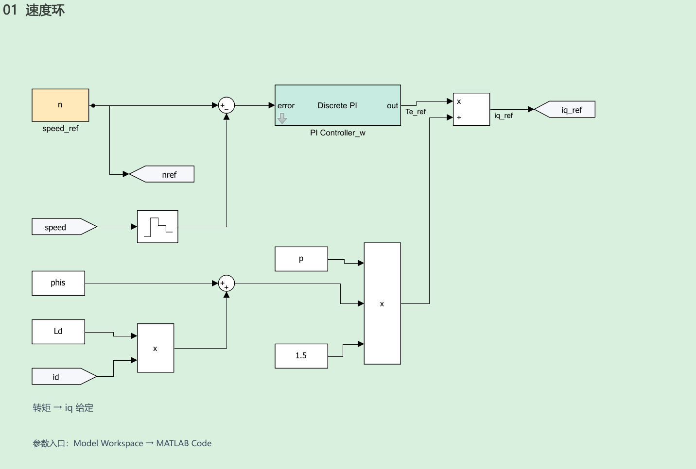
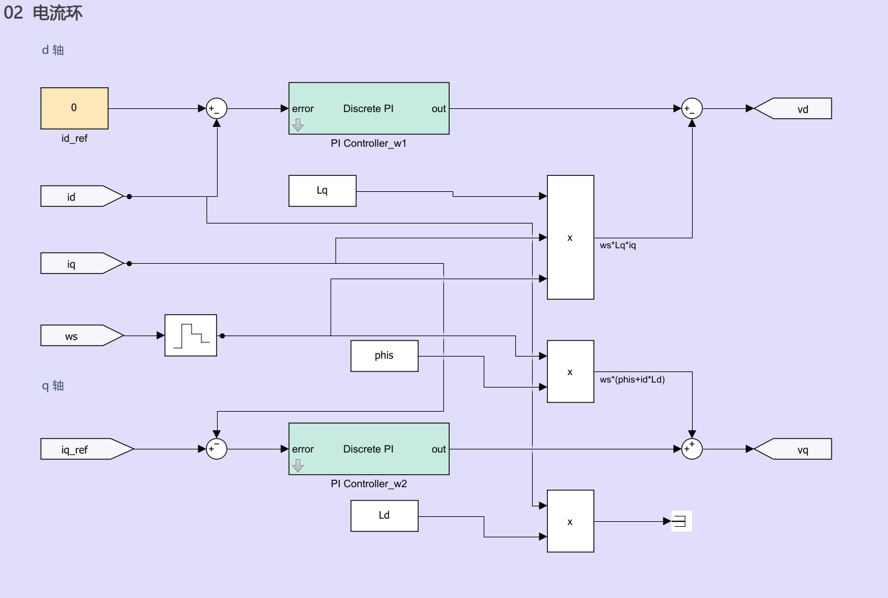
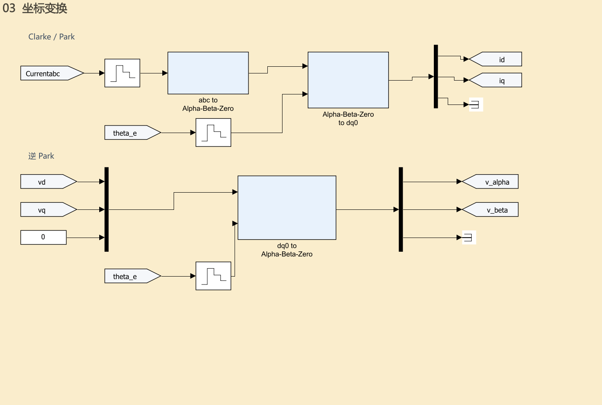
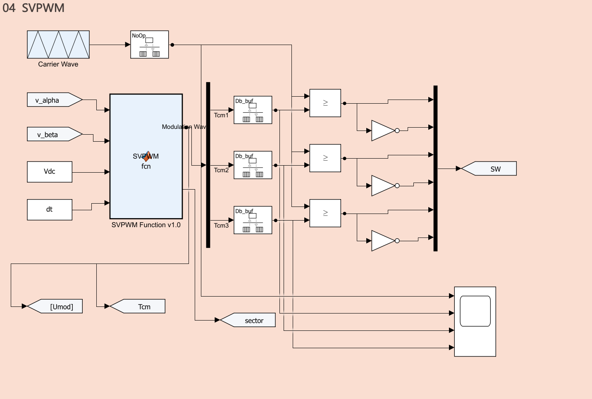
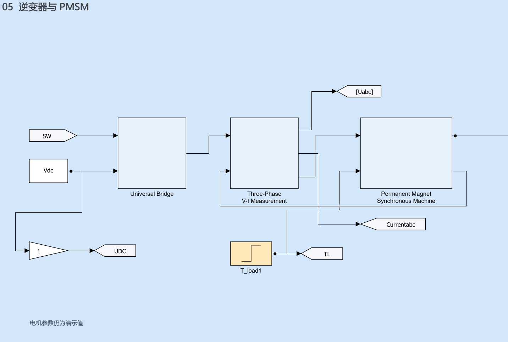
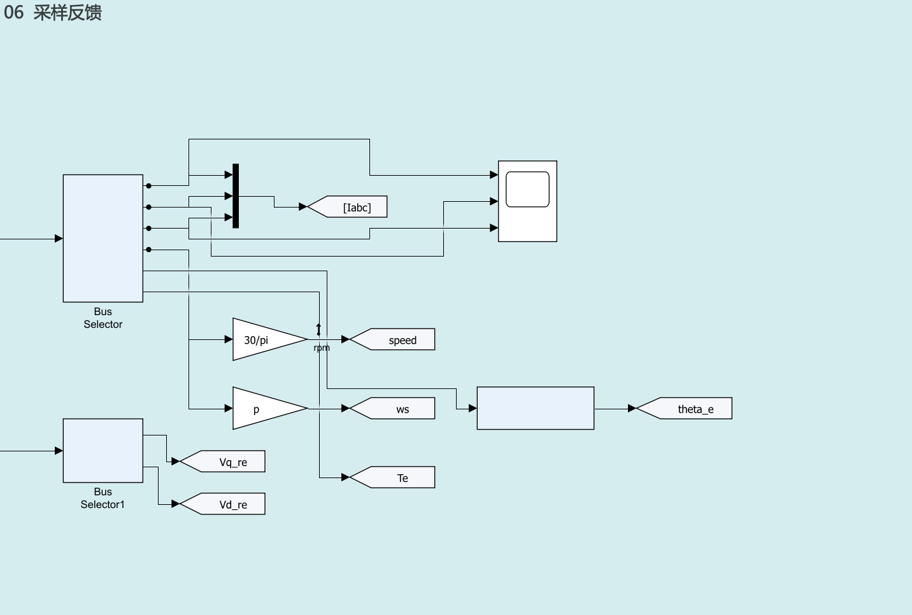
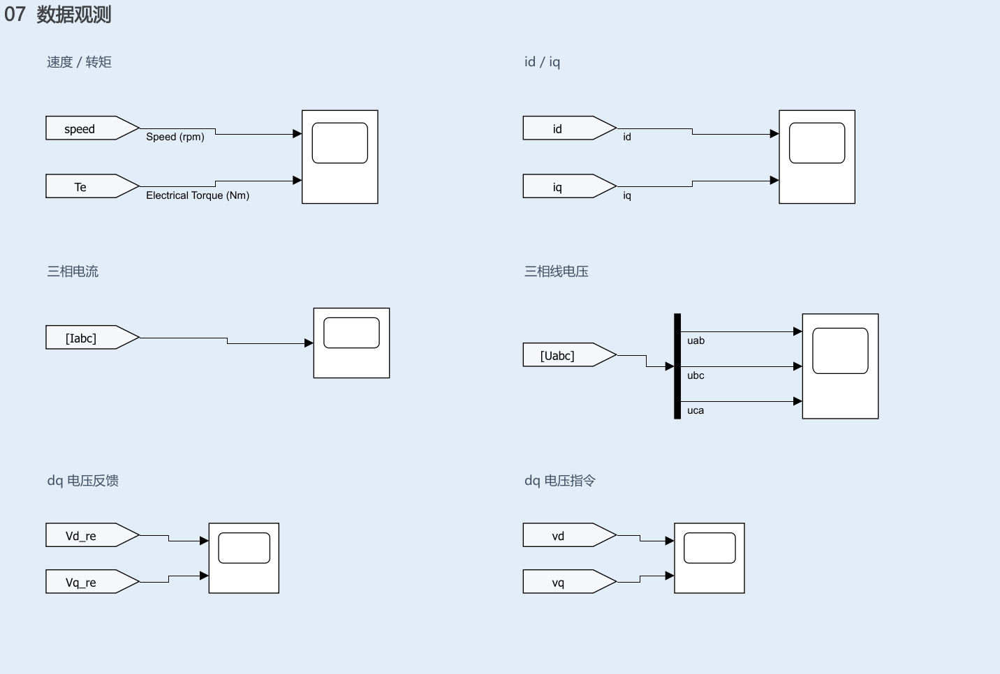
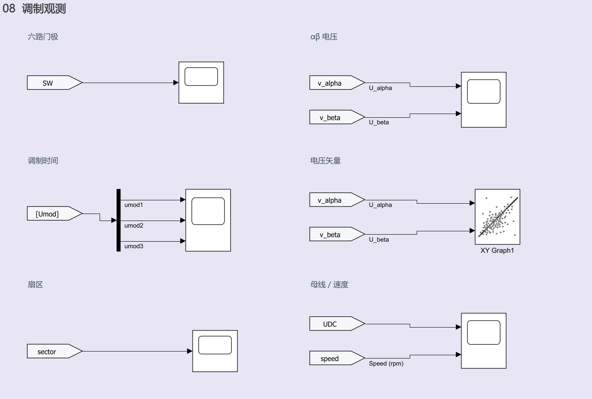
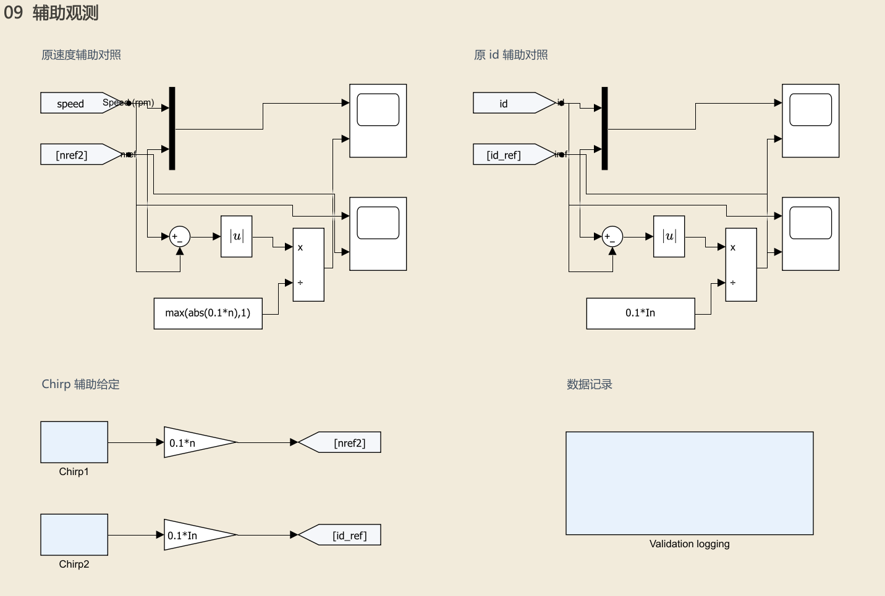

# PMSM FOC 模型逐模块解读

阅读对象是 `D:\simulink\modern\PMSM_FOC_R2026a.slx`，即已经确认布局的平铺模型。本文按画布上的九个色域解释控制链，再展开关键子系统，最后逐项登记全部 164 个顶层块和 165 个内部块。原作者为 SheeperXu，本文依据当前 R2026a 迁移版的实际参数、连接和源码整理。

这份模型可以用于学习 FOC 和开展后续开发。它采用理想开关桥、连续 dq 电机方程和理想状态反馈；真实开发板的采样电路、PWM 更新时刻、位置传感器和固件调度还没有接入。应先读懂当前实现，再按照配套开发计划逐项引入实际因素。

核对日期为 2026 年 10 月 11 日。模型 SHA256 为 `a745187d8a8b40986515717c7ebc6594f488e745b7f73bd922bf1bdc39b46994`。本次只读模型并编写文档，没有修改模型。MATLAB 为 R2026a Update 5，当前安装产品为 MATLAB 和 Simulink。

## 阅读方法

先顺着第 1 至第 6 个色域走完闭环，再读下方观测区域。遇到一个块，依次确认它接收什么、做什么、输出什么、单位是什么、在哪个时刻执行。块名保留当前文件中的英文名，中文说明与它一一对应。块名中的换行在文字中合并为空格；SID 是块的定位标识，不是执行顺序。

文中“当前实现”描述文件里的事实；“后续修改”是尚未应用的建议。能正常跑出转速，只能证明所测工况运行正常，不能证明单位、饱和处理和硬件行为都已经正确。

图示文件位于本目录 `handbook_assets`，均从当前模型的实际导出图裁出。各章末尾的逐块表给出每个小模块的作用和直接连线，关键子系统的内部块在附录中继续展开。

## 整条控制链

速度环根据转速误差提出转矩要求，再换成 q 轴电流给定。电流环把 d 轴与 q 轴电流误差换成电压要求。逆 Park 把旋转坐标系里的 dq 电压变成静止坐标系里的 αβ 电压。SVPWM 用母线电压和 αβ 电压计算开关比较阈值，再形成六路门极。逆变器产生三相电压，电机电流和转速随之变化。电流、速度与电角度反馈闭合环路。

| 色域 | 输入 | 输出 | 主要问题 |
| --- | --- | --- | --- |
| 01 速度环 | 转速给定和转速反馈 | iq_ref | 需要多大的转矩电流 |
| 02 电流环 | id_ref、iq_ref、id、iq、ωe | vd、vq | 需要施加多大的电压 |
| 03 坐标变换 | 三相电流、电角度、dq 电压 | id、iq、vα、vβ | 怎样在两种坐标系间表达同一个矢量 |
| 04 SVPWM | vα、vβ、Vdc、Ts | Tcm、sector、六路 SW | 怎样生成开关信号 |
| 05 逆变器与 PMSM | SW、Vdc、负载转矩 | 三相电流、机械状态、电磁转矩 | 电压怎样变成电流与运动 |
| 06 采样反馈 | 电机测量向量 | 三相电流、rpm、ωe、θe | 怎样整理反馈量 |
| 07 数据观测 | 电流、转速、电压与转矩 | Scope 波形 | 电机实际发生了什么 |
| 08 调制观测 | 门极、αβ 电压、Tcm、扇区 | Scope 和 XY 波形 | 调制是否按预期工作 |
| 09 辅助观测 | 实际状态、辅助 Chirp、日志标签 | 辅助比较和 log 数据 | 怎样诊断和留存结果 |

### 信号单位和方向

`speed`、`nref` 是 rpm；`wm` 是机械角速度 rad/s；`ws` 是电角速度 rad/s，尽管名字里没有 e，实际等于 p·wm。`theta_e` 是电角度 rad。`id`、`iq`、`iq_ref` 是 A，采用幅值不变变换的口径。`vd`、`vq`、`v_alpha`、`v_beta` 是 V。`Te`、`TL` 是 N·m。`Tcm` 是 s，`SW` 是六路逻辑开关状态。

`Uabc` 实际保存的是线电压 [Vab Vbc Vca]，不能按相对中性点的 [Va Vb Vc] 解读。`Iabc` 与 `Currentabc` 来自同一电机相电流的两条理想测量路径，前者主要观测，后者进入 Clarke/Park。`id_ref` 这个标签在辅助区表示 Chirp 信号；主电流环的 `id_ref` 块是直接接线的常量 0，二者不是同一个给定来源。

### 参数入口和当前数值

参数嵌入 Model Workspace 的 MATLAB Code，直接打开模型即可使用。不要再运行旧脚本里的 `clear all` 来初始化当前文件。

| 参数 | 当前值 | 含义 |
| --- | --- | --- |
| Vdc | 24 V | 恒定直流母线电压 |
| p | 4 | 极对数，机械一圈对应电角度四圈 |
| Rs | 0.14 Ω | dq 方程所用每相电阻 |
| Ld 和 Lq | 均为 120 μH | 当前按等电感 PMSM 建模 |
| phis | 0.0054 Wb | 永磁磁链 |
| J | 2.1×10⁻⁵ kg·m² | 转子与所建模负载的等效惯量 |
| F | 0.0001 N·m·s/rad | 黏性摩擦系数 |
| n | 3000 rpm | 主速度给定 |
| In | 9.2 A | 脚本中的额定电流参数，实际电机峰值或 RMS 口径待确认 |
| Tn | 0.29808 N·m | 按 1.5·p·phis·In 计算 |
| TL | 0.089424 N·m | 默认负载 0.3·Tn |
| fc | 20 kHz | 载波频率 |
| Ts 和 dt | 50 μs | PWM 周期及当前控制离散周期 |
| T | 1 μs | 连续系统固定求解步长 |
| fcb 和 fwb | 1000 Hz 与 50 Hz | 电流环和速度环的设计带宽参数 |
| StopTime | 1 s | 默认仿真时长 |

50 μs 是控制采样周期；1 μs 是计算电机连续状态的数值步长；50 Hz 是速度环设计带宽参数。这三个概念要分别理解。当前 `fwb` 与 `wsc=2*pi*50` 分别赋值，修改前者不会自动改写后者。

## 01 速度环

### 从给定到电流要求

`speed_ref` 输出常量 n=3000 rpm。`From` 读取标签 speed，经过 `Zero-Order Hold2` 以 dt=50 μs 保持后，送到 `Sum4` 的减号端。于是速度误差是目标转速减去实际转速。`Goto19` 把同一个真实目标转速发布为 nref，供日志使用。

速度低于目标时，误差为正，PI 增加驱动要求。速度高于目标时，PI 减少输出，必要时提出负转矩要求。PI 的输出被命名为 `Te_ref`，后面的 `Divide` 按转矩除以转矩系数，把它变成 `iq_ref`。这只是当前连线的单位意图；增益公式与这一单位意图尚存在不一致，下面单独说明。

### 下方乘法支路在算什么

`Constant3` 给出 Ld；`From35` 取得实际 id；`Product4` 计算 Ld·id。`Constant2` 给出 phis；`Sum6` 将两者相加。再由 `Constant1` 的 p、`Constant` 的 1.5 和 `Product` 相乘，得到当前模型使用的换算分母。

$$i_{q,ref}=\frac{T_{e,ref}}{1.5p(\psi_f+L_di_d)}$$

当前 id_ref=0，且稳态 id 接近 0，分母约为 0.0324 N·m/A。因此 0.1 N·m 的转矩要求对应约 3.09 A 的 q 轴电流要求。速度 PI 输出限幅为 ±1.2·Tn=±0.357696；按转矩解释并取 id=0 时，换算后的 iq_ref 约限制在 ±11.04 A。这是给定范围，实际电流仍可能有瞬态超调。

一般 PMSM 的电磁转矩为下式，来自当前电机子系统的实际方程。当前速度环换算中的 Ld·id 不能替代其中的 (Ld−Lq)·id。

$$T_e=1.5p[\psi_f+(L_d-L_q)i_d]i_q$$

当前 Ld=Lq、id≈0，掩盖了两种分母的区别。将来接入凸极电机或负 id 弱磁控制，需要一起修正换算，并检查分母范围。

### 速度 PI 的内部实现

进入 `PI Controller_w` 后，误差同时进入比例支路和积分支路。比例块 `Kp` 后有一个 dt 零阶保持。积分支路先经过抗饱和误差修正，再乘 Ki，进入后向欧拉离散积分器。积分器初值为 0，积分状态也限制在 downlimit 与 uplimit 之间。

`Add` 将比例项与积分项相加，还减去 `Gain1` 输出的 Bm·error。当前 Bm=0，所以这条附加支路不产生影响。它接的是误差信号，不能把它解释成实际机械摩擦 F·wm 的补偿。

`Saturation` 限制总输出。`Sum` 计算“限幅前输出减去限幅后输出”，`Gain` 乘 Ks，`Sum1` 再从原误差中减去它，然后送 Ki。其积分驱动关系为：

$$\dot x_I=K_i[e-K_s(u_{lin}-u_{sat})]$$

这意味着饱和反馈的等效积分增益是 Ki·Ks，不能把面板上的 Ks 直接当成常见写法中的独立 Kaw。后向欧拉使用当前离散时刻的积分输入；以后改成 C 代码时必须对齐更新顺序和离散方程，不能只复制 Kp、Ki 数字。

若忽略积分状态限幅，后向欧拉积分关系可写成下式，其中 Δu 是当前限幅前后之差，k 为离散时刻：

$$x_{I,k}=x_{I,k-1}+dt K_i(e_k-K_s\Delta u_k)$$

有状态限幅时还需按内部上下限约束。反馈若使用当前输出，这个关系可能包含隐式依赖，固件改用上一拍差值或不同更新顺序时会改变行为，必须用单步输入序列核对。

两个内部 Scope 分别看比例保持后的输出和积分输出。`Out` 输出限幅后的结果。14 个内部块的逐项说明见附录。

### 当前参数和两个待修问题

当前 kp_w≈0.0213232，ki_w≈1.3397774，ks_w=1.5·kp_w。脚本以 K=(30/π)·1.5·p·phis 计算 kp_w=J·wsc/K；其中已经包含电流到转矩的系数。可是模型又把 PI 输出按转矩使用并再次除以转矩系数。未来应明确“PI 直接输出 A”或“PI 输出 N·m”，同步统一增益、限幅和换算。

另一个问题是面板 `SampleTime=1/fwb=20 ms`，但内部零阶保持与积分器都直接引用 dt=50 μs。当前实际离散元件按后者执行，面板字段没有控制它们。20 ms 也不能由 50 Hz 带宽直接推导为合理的速度环执行周期。

### 怎样通过波形理解速度环

启动时实际转速为 0，而给定立即为 3000 rpm，误差很大，PI 容易进入限幅。随着电机加速，误差缩小。达到目标转速后，iq 通常仍然不为 0，因为负载和摩擦需要持续的电磁转矩。

默认 3000 rpm 对应 wm≈314.159 rad/s。稳态所需转矩近似为 TL+F·wm≈0.12084 N·m，对应 iq≈3.73 A。它是理想稳态平衡估计；控制周期采样的仿真均值会有开关纹波和采样差异。

阅读时对照 log_nref、log_speed、log_iq_ref、log_iq 和 log_Te。若做负载阶跃，应看到转速短暂下降、iq_ref 上升、实际 iq 跟随、转速恢复。当前默认 `T_load1` 前后值相同，原样运行没有负载跳变。

<!-- TOP_BLOCKS_01 -->

## 02 电流环

### 为什么分成 d 轴和 q 轴

d 轴沿着永磁磁链方向，q 轴与它正交。把旋转的三相电流变换到这个坐标系后，稳态电流可以接近直流量，便于 PI 调节。当前采用 id_ref=0，主要通过 iq 调整电磁转矩。d 轴仍然必须控制，不能因为给定为 0 就删除 d 轴环。

上方 `Sum` 的输出是 id_ref−id；下方 `Sum1` 的端口顺序是先减实际 iq、再加 iq_ref，结果仍然是 iq_ref−iq。识别加减号应按实际端口读，不能凭图形上下位置猜测。

### 两路 PI 与前馈

d 轴 PI 输出先经过 `Sum2`，减去 Product1 计算的 ωe·Lq·iq，形成 vd。q 轴 PI 输出与 Product3 的 ωe·phis 相加，形成 vq。`Zero-Order Hold5` 对 ws 做 dt 保持，供两条前馈支路使用。

$$v_d=u_{PI,d}-\omega_eL_qi_q$$

$$v_q=u_{PI,q}+\omega_e\psi_f$$

这些项用于抵消 dq 方程中的轴间耦合与反电动势，让电流 PI 主要面对电阻和电感动态。q 轴完整前馈应包含 ωe·(Ld·id+phis)，但当前 `Product2` 的 Ld·id 输出接到 `Terminator2`，没有进入 q 轴前馈。Product3 的图上名称注释可能使人误以为它包含 Ld·id，实际输入只有 ws 与 phis。当前 id≈0 时该遗漏项很小，非零 id 工况则需要修正。

### 电流 PI 参数怎样得到

参数脚本使用 wc=2π·1000，Kp=L·wc，Ki=Rs·wc。当前两轴电感相等，得到 Kp≈0.753982 V/A，Ki≈879.646 V/(A·s)。忽略耦合与延迟后，电流对象为 1/(Ls+Rs)，这一取值让 PI 零点对齐对象电气极点，是当前参数设计的出发点。

两路 PI 都使用后向欧拉、积分状态限幅和饱和误差反馈，结构与速度 PI 相似，但没有 Bm 支路。每个 PI 的 13 个内部块都在附录登记。

`PI Controller_w1` 虽然接在 d 轴，面板却引用 kp_iq、ki_iq、ks_iq 和 q 轴限幅。Ld=Lq 时数值恰好相同；将来只修改 kp_id，d 轴 PI 不会随之改变。这需要在参数关联上修复。

### 电压限制目前有什么缺口

两路 PI 各自限制为 ±Vdc/√3≈±13.8564 V。这是 PI 输出的单轴限幅，之后还要叠加前馈。即使两个 PI 都没有超过各自上限，最终 dq 电压矢量也可能超出逆变器线性调制能力。

$$\sqrt{v_d^2+v_q^2}\leq V_{dc}/\sqrt{3}$$

这个约束适用于当前幅值不变坐标系和线性 SVPWM 电压圆。后续应对最终电压矢量限幅，并将实际可实现电压的差值反馈到抗积分饱和；不能只在 SVPWM 末端强行裁剪而让积分器继续累积。

### 应该看到什么波形

id 应围绕 0 波动；iq 应跟随 iq_ref。启动、负载变化和反转时，iq 会明显变化。vd、vq 的符号与幅值由电阻压降、动态电流和前馈共同决定，不能认为“id=0 所以 vd 也一定为 0”。例如在转动时，d 轴为抵消 −ωe·Lq·iq 耦合，通常需要非零 vd。

先比较电流误差、PI 未限幅输出、PI 限幅输出、叠加前馈后的最终电压，再判断跟踪异常来自参数、饱和还是时序。当前日志没有记录所有中间量，这些是后续观测扩展建议。

<!-- TOP_BLOCKS_02 -->

## 03 坐标变换

### 上半部分把三相电流变成 dq 电流

`From4` 读取 Currentabc，经 `Zero-Order Hold1` 采样后，进入 `abc to Alpha-Beta-Zero`。它的核心是一个矩阵 Gain；当前使用幅值不变 Clarke 变换。

$$i_\alpha=\frac{2}{3}i_a-\frac{1}{3}i_b-\frac{1}{3}i_c$$

$$i_\beta=\frac{i_b-i_c}{\sqrt{3}},\qquad i_0=\frac{i_a+i_b+i_c}{3}$$

幅值不变意味着平衡正弦相电流的峰值与 αβ 矢量幅值一致。采用这种约定时，dq 电流稳态幅值对应相电流峰值，不能直接把电机铭牌 RMS 电流原数值代入所有限幅。

`From1` 读取 theta_e，经 `Zero-Order Hold3` 保持，再进入 `Alpha-Beta-Zero to dq0`。其内部两个 Fcn 执行 Park 变换，一个 Fcn 直接传递零序分量：

$$i_d=i_\alpha\cos\theta_e+i_\beta\sin\theta_e$$

$$i_q=-i_\alpha\sin\theta_e+i_\beta\cos\theta_e$$

`Demux` 把 [id iq i0] 拆开，`Goto2` 和 `Goto3` 发布 id、iq，零序输出进入 `Terminator`。当前浮动星点电机不提供零序电流动态，平衡相电流满足 ia+ib+ic≈0。

### 下半部分把 dq 电压变回静止坐标系

`From9` 与 `From10` 取得 vd、vq，`Constant5` 给出零序电压 0，`Mux1` 合成 [vd vq 0]。`From11` 与 `Zero-Order Hold4` 提供同一电角度约定。逆 Park 内部执行：

$$v_\alpha=v_d\cos\theta_e-v_q\sin\theta_e$$

$$v_\beta=v_d\sin\theta_e+v_q\cos\theta_e$$

`Demux1` 拆出 vα、vβ、v0，前两路通过标签进入 SVPWM，零序支路接终止块。丢弃零序电压不代表 SVPWM 没有共模注入；空间矢量零矢量安排仍会改变桥臂共模电压。

### 角度与相序为什么必须一致

θe=0 时，Park 变换输出 id=iα、iq=iβ。θe=π/2 时，id=iβ、iq=−iα。拿这两个角度做手算，可以快速检查符号。再把任意 [vd vq] 先逆 Park 再 Park，应恢复原数值，这是后续单元验证的一个检查。

当前电角度来自电机真实机械角度乘极对数，变换与电机子系统使用相同相序。实际板子会多出传感器零位偏移、方向、滤波和延迟。即使 PI 数值正确，角度偏差也会把 q 轴电流投到 d 轴，出现电流增大而有效转矩不足的问题。

后续先确认 abc 相序、角度正方向、d 轴零位与峰值口径，再接编码器、霍尔或观测器。反馈方式尚未确定，本文不预设一种传感器方案。

<!-- TOP_BLOCKS_03 -->

## 04 SVPWM

### 函数输入输出

`SVPWM Function v1.0` 的四个输入依次是 alpha、beta、Vdc、Ts。当前 Constant9 的值是 dt，而工作区里 dt=Ts=50 μs；若以后把两者分开，必须检查该端口应继续传入 PWM 周期 Ts。函数输出 Tcm 三元素向量和 sector 编码。

Tcm 是三相比较阈值，单位 s，正常线性调制范围为 0 至 Ts/2，也就是 0 至 25 μs。它不是 0 至 1 的占空比，更不是 STM32 的 CCR 计数值。

### 扇区编码

函数先构造 ref1=β、ref2=−β/2+√3·α/2、ref3=−β/2−√3·α/2，分别判断是否大于 0，再用 sector=4c+2b+a 编码。这里的 sector 数字与常说的空间扇区编号不同。

| 物理扇区 | I | II | III | IV | V | VI |
| --- | --- | --- | --- | --- | --- | --- |
| 函数编码 | 3 | 1 | 5 | 4 | 6 | 2 |

原函数注释把最后一项写成 12，但实际编码只能由三个二值位组合，运行代码对应 2。文档按代码解释，不按这条注释解释。

### 有效矢量时间与开关阈值

中间量 X、Y、Z 已带有 Ts/Vdc，所以单位都是时间。函数按扇区从它们选择 t1、t2，计算两个有效电压矢量需要的作用时间。

$$X=\frac{\sqrt{3}T_s}{V_{dc}}\beta$$

$$Y=\frac{\sqrt{3}T_s}{2V_{dc}}(\sqrt{3}\alpha+\beta),\quad Z=\frac{\sqrt{3}T_s}{2V_{dc}}(-\sqrt{3}\alpha+\beta)$$

函数中的 t0=(Ts−t1−t2)/2，是分配到半周期的零矢量时间量。随后 ta=t0/2、tb=ta+t1/2、tc=tb+t2/2，再按 sector 排列成 [TcmA TcmB TcmC]。附录保存当前完整函数，便于对照每个 switch 分支。

### 载波比较和六路门极

`Carrier Wave` 产生时间型三角波：[0 Ts/2 Ts] 对应 [0 Ts/2 0]。`Demux2` 把 Tcm 拆成三路，经 `Rate Transition1` 至 `3` 分别进入比较器。载波经 `Rate Transition4` 进入三个比较器的第一个输入。

三个比较器执行 carrier≥Tcm，形成 A、B、C 上管信号；`NOT`、`NOT1`、`NOT2` 生成对应下管信号。`Mux2` 按 [AH AL BH BL CH CL] 的顺序合并，`Goto12` 发布 SW。当前下管是上管的严格逻辑取反，没有死区。

对于固定阈值和这个三角波，理想上管占空比为下式。因此接入固件时应按实际 PWM 极性、计数方式与 ARR/CCR 规则转换，不能直接令 duty=Tcm/Ts。

$$d_A=1-\frac{2T_{cm,A}}{T_s}$$

四个 Rate Transition 当前输出周期字段为 −1，表示继承；它们的存在不能证明已经实现真实 MCU 的一个 PWM 周期延迟或 CCR 预装载。后续时序需要明确建模。

### 过调制问题

当前函数在 t1+t2>Ts 时，先修改 t1，再用已经修改后的 t1 计算 t2，两个时间没有用同一个原始总和归一化。取 α=12 V、β=12 V、Vdc=24 V、Ts=50 μs，原始总和约 59.150635 μs，处理后仍约 51.582857 μs；三相阈值中会出现负值及超过 25 μs 的值。

后续应先保存 total=t1+t2，再让 t1、t2 同时乘 Ts/total，并检查零矢量时间与三相阈值范围。这个修复还应与最终电压矢量限幅、PI 抗饱和同步验证。本文没有改动函数。

### 零矢量和观测支路

α=β=0 时 sector=0。当前第二个 switch 没有 sector=0 分支，Tcm 保持初始化的 [0 0 0]。因此理想比较器会使三个上管都导通，三相线电压仍为 0；但它与三相 50% 占空比的共模电压和采样窗口不同。后续要为零矢量规定与固件一致的行为。

`Scope6` 直接比较载波与三个阈值；`Goto17` 把同一 Tcm 向量发布为 Umod，`PWM threshold tag` 发布为 Tcm，供日志使用。两个标签并不是两种不同的调制结果。`Goto13` 发布 sector，用来检查扇区切换。

<!-- TOP_BLOCKS_04 -->

## 05 逆变器与 PMSM

### 母线和理想逆变器

`DC Voltage Source` 当前是 Constant，输出 Vdc=24 V。`Voltage Measurement` 是 Gain 1，直接把同一数值发布为 UDC，没有分压、电容动态或 ADC 误差。`From13` 读取六路 SW，送入 `Universal Bridge`。

这个同名逆变器已由旧 SPS 块替换为普通 Simulink 子系统。它先把六路逻辑信号转成 double，再拼接母线电压，用三个 Fcn 计算浮动星点负载的相电压。令 sA=AH−AL、sB=BH−BL、sC=CH−CL，则：

$$v_a=\frac{V_{dc}}{6}(2s_A-s_B-s_C)$$

$$v_b=\frac{V_{dc}}{6}(2s_B-s_A-s_C),\quad v_c=\frac{V_{dc}}{6}(2s_C-s_A-s_B)$$

这等价于先生成桥臂极点电压，再减去浮动中性点电压。三相相电压之和为 0；以 [AH BH CH]=[1 0 0] 且下管互补为例，输出为 [16 −8 −8] V，线电压 Vab=24 V。

公式只适用于当前理想互补开关约定。它没有 MOSFET 导通压降、二极管续流、开关过渡、死区或母线动态。上下管同时关断时，相电压实际取决于电流方向与续流路径，当前算式不能正确描述这一状态。因此增加死区时必须同时扩展逆变器模型。

### 三相测量模块

`Three-Phase V-I Measurement` 的第一个输入是相电压，第二个输入是电机输出的三相电流。它的三个输出依次是 [Vab Vbc Vca]、Iabc 和原样传给电机的 Vabc。

内部 Vab、Vbc、Vca 三个 Fcn 分别做 va−vb、vb−vc、vc−va，`line_voltage` 组合线电压。电流直接通过，未增加测量噪声、比例误差或滤波。`Measured phase currents` 将它发布为 Currentabc，供控制反馈；`Goto4` 发布的是线电压 Uabc。

### 电机输入与状态

`Permanent Magnet Synchronous Machine` 当前是连续 dq 方程子系统。输入端口 1 是 Vabc，端口 2 是负载转矩。内部连续积分器 `id_iq_wm_theta` 保存四个状态，初值全部为 0：

$$x=[i_d,i_q,\omega_m,\theta_m]^T$$

`v_state_load` 将三相电压、四个状态和负载拼成一个八元素向量，顺序为 [va vb vc id iq wm theta_m TL]。所有电机 Fcn 都按这个顺序读取 u(1) 至 u(8)，不能调换 Mux 端口而仍沿用原表达式。

### 电流和机械运动怎样计算

电机先按 θe=p·θm 将输入相电压变为实际 dq 电压，再计算四个状态的变化率：

$$\frac{di_d}{dt}=\frac{v_d-R_si_d+\omega_eL_qi_q}{L_d}$$

$$\frac{di_q}{dt}=\frac{v_q-R_si_q-\omega_e(L_di_d+\psi_f)}{L_q}$$

$$T_e=1.5p[\psi_fi_q+(L_d-L_q)i_di_q]$$

$$\frac{d\omega_m}{dt}=\frac{T_e-T_L-F\omega_m}{J},\qquad\frac{d\theta_m}{dt}=\omega_m$$

`did_dt`、`diq_dt`、`dwm_dt`、`dtheta_dt` 的单位依次是 A/s、A/s、rad/s²、rad/s。`derivatives` 将它们按状态顺序组合，再交给连续积分器。电流是根据实际相电压和电机状态算出来的，没有直接用 iq_ref 伪造电流反馈。

当前 Ld=Lq，使凸极转矩项为 0；惯量与黏性摩擦决定速度动态。模型没有温升引起的 Rs 变化、磁饱和、磁链谐波、齿槽转矩、轴系弹性或干摩擦。后续增加哪些项，应由真实电机和需要解释的实测误差决定。

### 电机输出顺序

`ia`、`ib`、`ic` 将连续 dq 电流按当前电角度变回三相。`wm`、`theta_m` 取出机械状态；`Te` 计算转矩；`vq_actual` 与 `vd_actual` 从实际相电压计算 dq 电压。`measurement` 组合成以下向量：

| 索引 | 1 | 2 | 3 | 4 | 5 | 6 | 7 | 8 |
| --- | --- | --- | --- | --- | --- | --- | --- | --- |
| 内容 | ia | ib | ic | wm | θm | Te | vq_actual | vd_actual |

端口 1 输出这个八元素向量，端口 2 输出单独的 Iabc 向量。后续两个 `Bus Selector` 名称沿用旧模型，但实际是普通向量拆分子系统，不是原来的电气测量总线块。

### 负载和求解器

`T_load1` 是 Step，Time=0、Before=After=0.3·Tn、SampleTime=dt，所以默认实际施加恒定负载。`Goto18` 只是把这个 TL 复制给日志，电机由直接连线接收负载。反转工况时应明确负载的物理方向；恒定正 TL 与始终阻碍旋转的负载不是同一种数学定义。

电机连续状态由 ode4 按 T=1 μs 求解，控制采样为 50 μs。20 kHz 周期只有 50 个求解步，开关边沿和采样峰值仍受步长影响。已有步长减半验证只确认了稳态速度的一致性，不能证明高频纹波完全收敛。

### 参数一致性

脚本写了 Pn=200 W，但当前 Tn=0.29808 N·m 在 3000 rpm 对应机械功率约 93.64 W；200 W 在同一转速下约需 0.63662 N·m。实际电机额定电流、转矩常数和功率口径尚未确认，不能只凭 Pn 字段认定仿真覆盖了 200 W 额定点。

<!-- TOP_BLOCKS_05 -->

## 06 采样反馈

### 两个向量拆分器

`Bus Selector` 用一个八路 Demux 拆开测量向量，输出前六路 ia、ib、ic、wm、θm、Te；末两路在内部接 Terminator。`Bus Selector1` 也拆同一个向量，但只输出第 7 路 vq_actual 和第 8 路 vd_actual，其余六路终止。

第一个拆分器的前三路通过 `Mux` 重新组成 Iabc，发布到标签并进入本区 Scope。第六路 Te 通过 `Goto5` 发布。两个拆分器并没有滤波、量化或传输延迟。

### 机械速度和电速度

`Gain` 的 30/π 将 wm 从 rad/s 转为 rpm，`Goto6` 发布 speed。`Gain1` 乘 p，将 wm 转为电角速度，`Goto1` 发布 ws。3000 rpm 时 wm≈314.159 rad/s，ws≈1256.637 rad/s，对应电频率 200 Hz。

$$n=\omega_m\frac{30}{\pi},\qquad\omega_e=p\omega_m,\qquad f_e=\frac{pn}{60}$$

把 rpm 误接到需要 rad/s 的前馈端，会产生 30/π 或 2π/60 的比例错误。把机械角速度直接用于 dq 前馈，则少乘极对数。

### 电角度生成

`Subsystem` 接收 θm，内部 `Gain1` 乘 p，`Constant` 给出 2π，`Mod` 取模，输出 theta_e。内部 Scope 查看这个电角度。`Electrical Rotation Angle` 将其发布给 Park 和逆 Park。

$$\theta_e=\operatorname{mod}(p\theta_m,2\pi)$$

θm 由电机积分得到，是真实状态；当前没有编码器计数、霍尔换相、SPI 读角、角度零位误差或估算器。脚本中的 RE=1024 与 rr=2π/1024 没有进入这条主角度反馈链，不能据此说模型已经使用了 1024 线编码器。

### dq 电压反馈

`Goto14` 发布 Vq_re，`Goto15` 发布 Vd_re。它们是实际开关相电压按电机角度变换后的瞬时值；控制器的 vd、vq 是电压要求。由于 PWM 和采样，不应要求两类瞬时波形每一点都相等。比较平均电压或同相位采样值时，应明确窗口和采样时刻。

后续板级反馈应在本区和坐标变换输入附近加入电流前端、ADC 编码、角度接口、滤波与有效性标志，并保留真实状态作为诊断对照。控制器只能用模拟测量值，避免不小心继续读取理想状态。

<!-- TOP_BLOCKS_06 -->

## 07 数据观测

本区只读取标签，不向控制环输出。From 标签相当于把另一处 Goto 发布的同一信号拉过来，不会自动增加延迟。以下 Scope 名称均是当前文件中的真实块名。

| Scope | 实际输入顺序 | 怎样解读 |
| --- | --- | --- |
| Scope1 | speed、Te | 看转速与电磁转矩；单位不同，应分别读轴或分图 |
| Scope8 | id、iq | 看两轴电流与纹波；这里没有 iq_ref 输入 |
| Scope3 | Iabc 三元素向量 | 看三相电流平衡、相序和峰值 |
| Scope4 | Vab、Vbc、Vca | 看三相线电压的 PWM；不能当相电压 |
| Scope14 | Vd_re、Vq_re | 看电机端实际 dq 开关电压 |
| Scope15 | vd、vq | 看控制器最终 dq 电压要求 |

`Demux3` 只拆开 Uabc 的三元素线电压向量。其他小块都是相应物理量的 From，不改变数值。原 Scope 的量程和历史缩放可能不适合当前启动波形，阅读时可用自动缩放；这不改变控制算法。

先看启动阶段 0 至 0.1 s 的速度和 iq，再看稳态的一段电周期。3000 rpm、p=4 时一个电周期为 5 ms；看 PWM 细节则要缩到几十微秒级。只看整整 1 s 的窗口，会把电流纹波压成一条粗线。

已有 log 记录为控制周期采样；若要评估 PWM 边沿、死区或真实电流尖峰，必须另按足够高的时间分辨率记录对应信号。不能用每周期一个样本证明开关细节正确。

<!-- TOP_BLOCKS_07 -->

## 08 调制观测

| Scope 或记录块 | 实际输入顺序 | 应检查的内容 |
| --- | --- | --- |
| Scope2 | SW 六路向量 | 相邻两路是否互补；当前无死区 |
| Scope5 | v_alpha、v_beta | 电压要求的幅值与相位 |
| Scope11 | TcmA、TcmB、TcmC | 阈值是否在 0 至 Ts/2 内 |
| XY Graph1 | 横轴 v_alpha、纵轴 v_beta | 电压矢量轨迹；不是转子空间轨迹 |
| Scope7 | sector | 按 3、1、5、4、6、2 的物理顺序理解编码 |
| Scope9 | UDC、speed | 母线与速度，单位不同；当前 UDC 应恒为 24 V |

`Demux5` 拆的是 Umod，也就是 Tcm 时间向量。XY Graph 的稳态轨迹可以辅助判断电压矢量是否旋转，但不能单独证明扇区边界或过调制正确。正确的调制验证还要检查有效矢量时间、开关次序、比较极性与逆变器平均电压。

后续建议将“扇区边界”“零矢量”“高调制度”“Vdc 突变”作为独立测试。门极互补只说明没有同时逻辑导通，不能证明硬件已经具有足够死区，也不能证明实际过流保护有效。

<!-- TOP_BLOCKS_08 -->

## 09 辅助观测

### 两路 Chirp 的实际用途

`Chirp1` 内部用一个 0 至 10 s 的循环斜坡作为时间，再计算 cos(π·500·t²/10)，并以 dt 保持。瞬时频率从 0 Hz 线性扫到 500 Hz，每 10 s 重复。`Gain3` 乘 0.1·n=300，`Goto21` 发布 nref2。

`Chirp2` 的同类表达式为 cos(π·5000·t²/10)，10 s 内扫到 5000 Hz。`Gain2` 乘 0.1·In=0.92，`Goto20` 发布 id_ref。默认仿真只有 1 s，因此两路频率分别只扫到约 50 Hz 和 500 Hz。

这两路没有接到主速度或主 d 轴给定端。它们不能作为已完成闭环扫频的证据。要真正测闭环频响，应以后把小信号注入对应给定，并控制工作点、限幅与扰动幅值。

### 速度辅助对照

`From28` 读取实际 speed，`From36` 读取 nref2。`Mux3` 将二者组合；`Sum5` 计算 nref2−speed；`Abs` 取绝对值；`Divide1` 除以 `Constant11` 的 max(abs(0.1·n),1)。当前分母为 300 rpm，零速时下限 1 rpm 用来避免除零。

`Scope10` 的两端口分别接 Mux3 的双信号向量和归一化绝对误差；`Scope12` 直接接实际速度与 nref2。因为 nref2 不是主给定，这里的差值不是主速度跟踪误差。

### d 轴辅助对照

`From15` 读取 id，`From7` 读取辅助标签 id_ref。`Mux4` 合成两路；`Sum7` 计算辅助 id_ref−实际 id；`Abs1` 取绝对值；`Divide2` 除以 `Constant13` 的 0.1·In=0.92 A。`Scope13` 看双信号向量与归一化误差，`Scope16` 直接看两路输入。

这里的辅助 id_ref 与电流环主 Constant id_ref=0 不同。辅助区看起来有“给定与反馈”，但不能据此推断主 d 轴正在跟踪 Chirp。

### 日志子系统

`Validation logging` 内有 12 个 From 和 12 个 To Workspace。它们以 dt=50 μs 保存 timeseries，不进入控制反馈。记录名与标签对应如下：

| 变量 | 来源标签 | 单位或排列 |
| --- | --- | --- |
| log_speed | speed | rpm |
| log_nref | nref | rpm，真实主给定 |
| log_id | id | A |
| log_iq | iq | A |
| log_iq_ref | iq_ref | A |
| log_Te | Te | N·m |
| log_TL | TL | N·m |
| log_UDC | UDC | V |
| log_v_alpha | v_alpha | V |
| log_v_beta | v_beta | V |
| log_SW | SW | [AH AL BH BL CH CL] |
| log_Tcm | Tcm | [TcmA TcmB TcmC]，s |

默认 1 s 记录每路 20001 个时刻，含起止点。这个样本数不表示求解器只计算了 20001 步。以后需要增加真实 id_ref、θe、采样有效性、PI 饱和状态和 CCR 生效时刻等诊断量，再用于固件对比。

<!-- TOP_BLOCKS_09 -->

## 已有验证能证明什么

布局整理时，所有 329 个显式块的路径、SID、参数、连接、遮罩、工作区代码与 MATLAB Function 源码保持一致。默认 1 s 的 12 路日志与整理前逐点一致，最大差值为 0，未解析库链接为 0。这证明布局整理没有改变这份模型的原有计算行为。

现有五组运行检查覆盖默认给定、零速零负载、反转、负载阶跃和求解步长减半。它们检查有限数值、门极互补、正常测试工况中的阈值范围及稳态速度。它们没有覆盖全部过调制、真实硬件死区、实际 ADC 时序、角度误差、开发板故障或固件数值一致性。

默认末 20 ms 转速约 3000.003 rpm；零速为 0；反转约 −1500.000 rpm；负载阶跃后约 2999.996 rpm。步长减半后的稳态速度相近，但启动 iq 的控制周期采样峰值仍变化约 2.1%，因此高频细节仍应做专门收敛检查。

## 建议的逐块学习顺序

第一轮读速度环的给定、误差和转矩到电流换算，能说清负载增加后 iq 为什么增加。第二轮展开 PI，比较比例、积分、输出限幅与积分状态限幅。第三轮读电流环及前馈，手算每条支路的符号和单位。第四轮读坐标变换，用 0 和 π/2 检查角度约定。第五轮读 SVPWM，用一个扇区和零矢量走完函数。第六轮读逆变器与电机状态方程，再回头对照所有日志。

每读完一轮，都用“输入改变后，哪一个量先变，哪一个量后变，为什么”解释波形。确认这些因果关系后，再开始算法修复和硬件适配。

## 附录 内部小模块逐项说明

<!-- INTERNAL_BLOCKS -->

## 附录 当前 SVPWM 函数

以下代码来自当前模型内嵌 MATLAB Function，保留现状以便阅读。上文已解释过调制顺序赋值、扇区注释和零矢量行为，不应把本段直接当成已修正固件。

<!-- SVPWM_SOURCE -->
