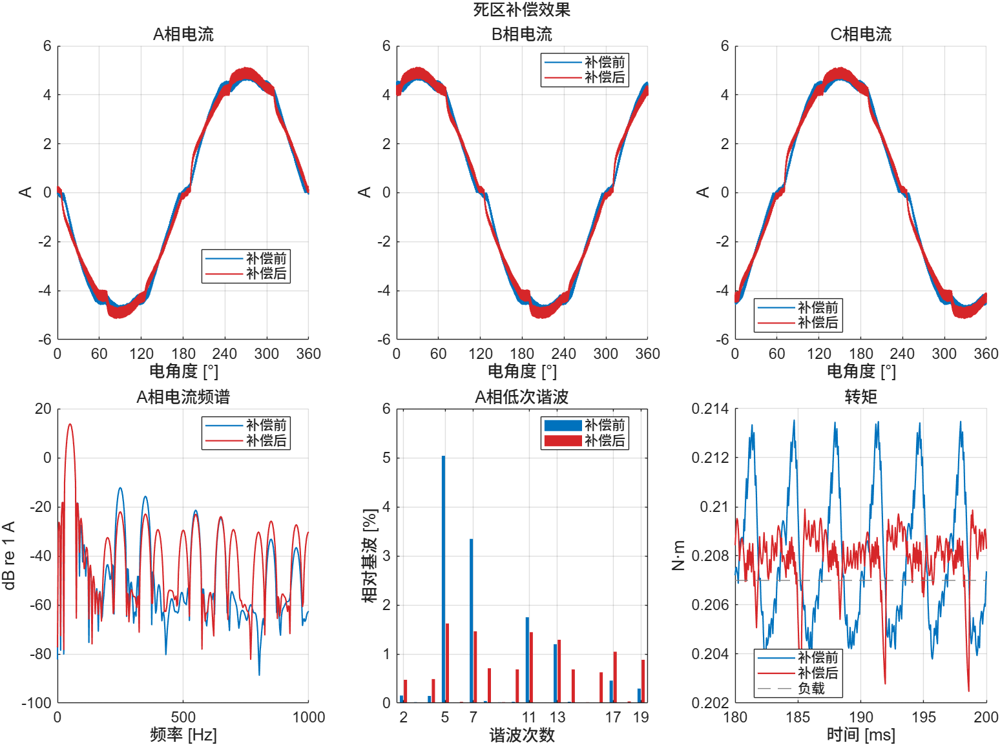
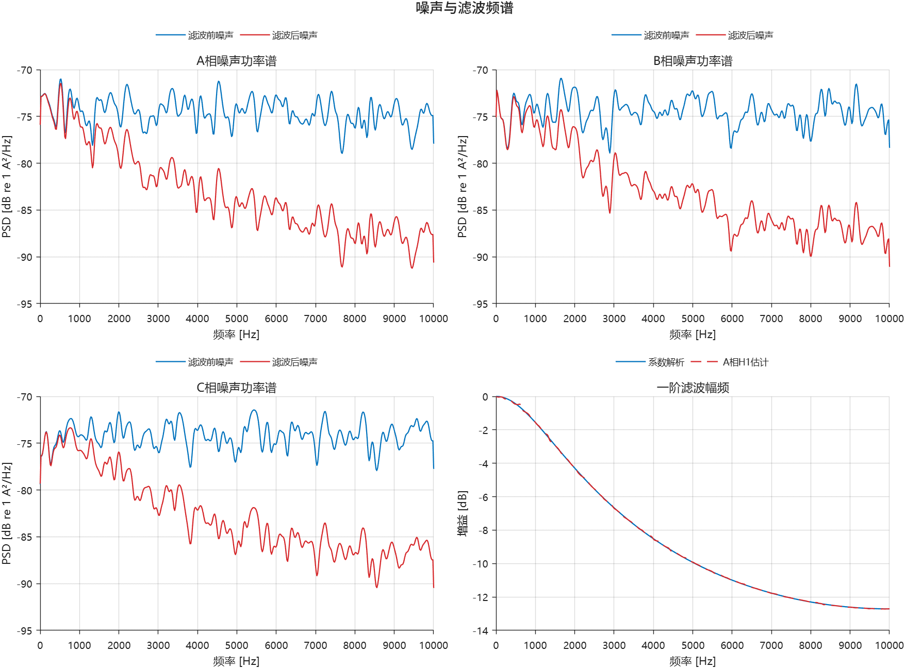
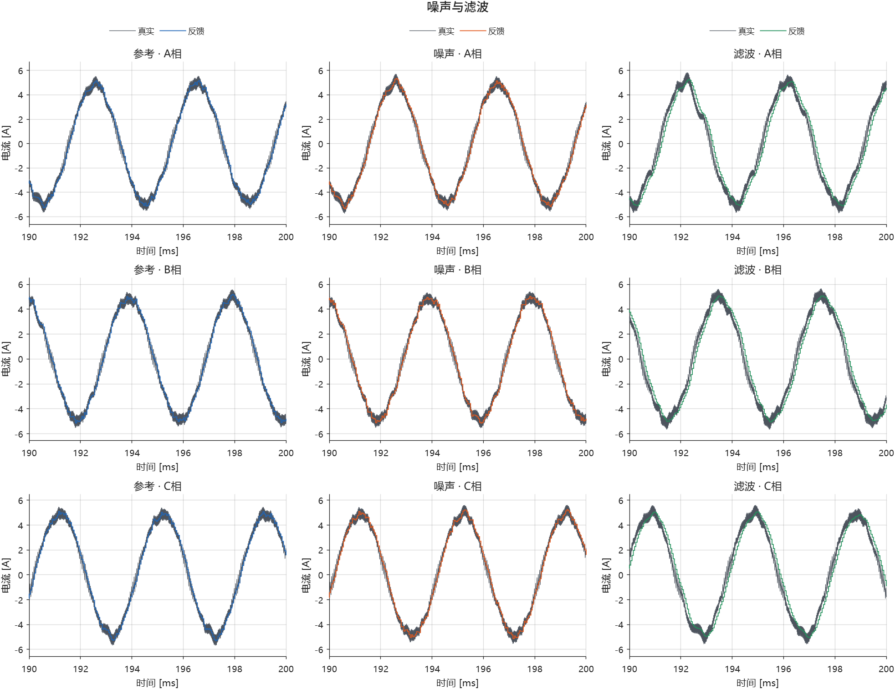
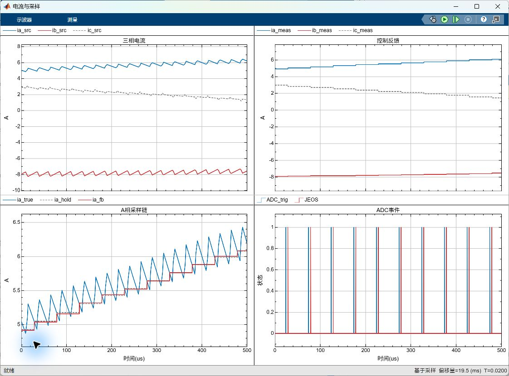
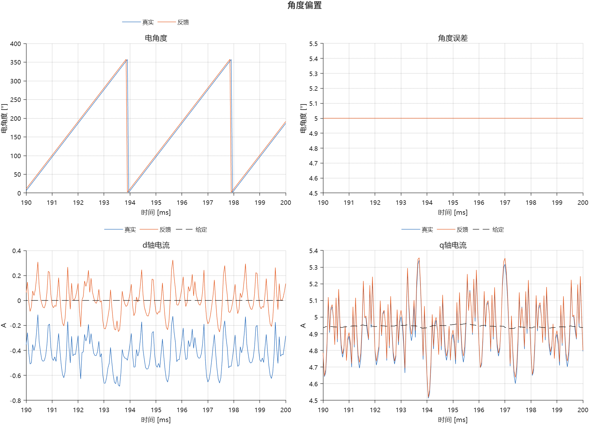
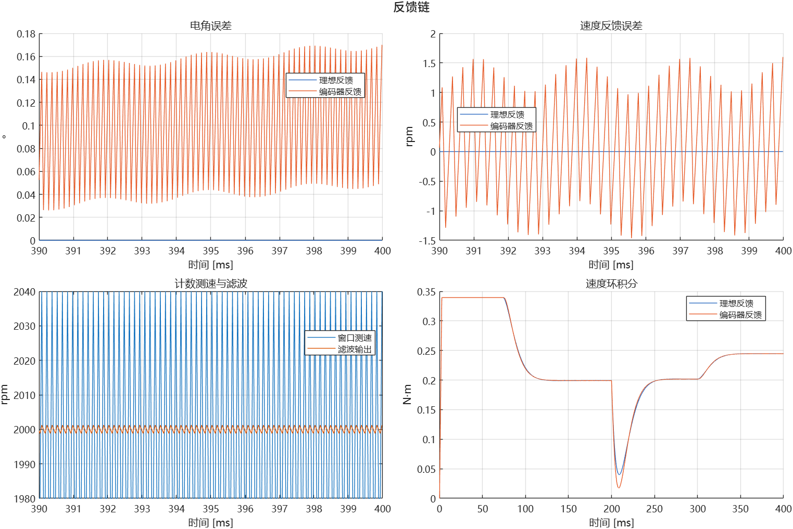
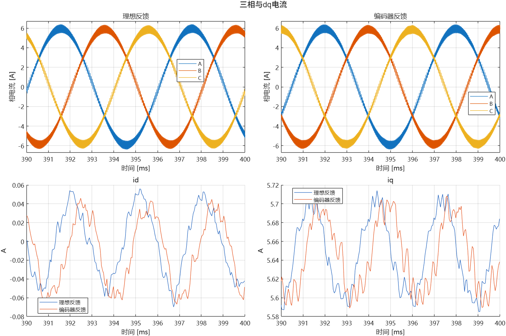
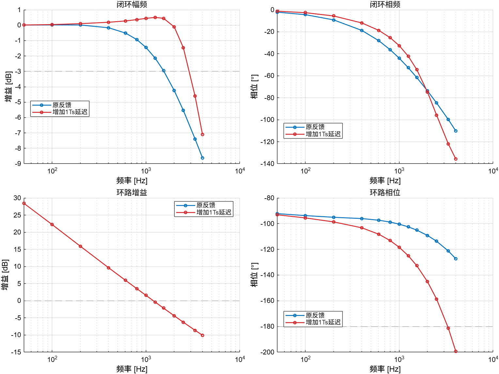
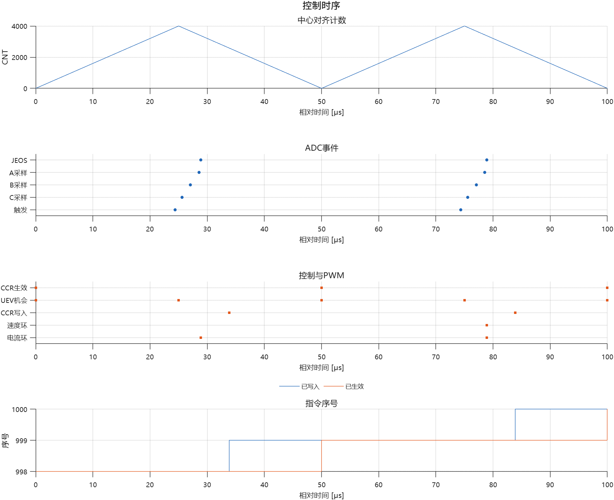

# 非理想因素PPT图片精选

优先使用01–07，08–09适合技术细节页。图片原样复制，未平滑、加点、移相或夸大差异；本次未重跑物理仿真。部分历史图保留原配色。

## 已考虑的因素

- 功率：门极死区、续流路径、器件导通压降、基础极性前馈补偿。
- 测量：增益、零偏、噪声、ADC量化/量程、模拟与数字低通、延迟。
- 时序：PWM中心对齐、顺序ADC、JEOS、任务分频、计算耗时、CCR量化/预装载/更新等待。
- 采样窗口：低侧有效性与无效样本处理策略。
- 位置/速度：角度偏置、计数量化与读取延迟、窗口差分测速、一阶速度低通。
- 电机与工况：Rs、Ld/Lq、磁链、极对数、惯量、粘性摩擦、恒定母线及负载变化参数。

基础参数可配置不等于已包含温升、磁饱和或母线动态。未完成实板校准、完整保护、自动电角定位或完整CPU并发调度；单项验证不等于任意组合验证。

## 建议宣传句

将逆变器非线性、采样误差与数字控制时序纳入同一个PMSM FOC教学和算法验证框架，以可开关因素、同工况对照和可复现实验，连接理想控制原理与嵌入式实现。

## 01_死区补偿综合效果.png

建议页标题：死区、低次谐波与转矩脉动

同工况600rpm、24V、0.207N·m、2µs死区的补偿前后；电流按电角度，频域120–200ms，转矩180–200ms。5/7次下降，部分高次上升；不是全带宽THD。

## 02_噪声与滤波功率谱.png

建议页标题：从噪声功率谱观察滤波作用

三相噪声分量滤波前后PSD，配合系数解析与H1估计幅频；不是电机整条相电流的PSD。

## 03_三相采样九宫格.png

建议页标题：三相电流的真实值与数字反馈

三列为参考、固定噪声、同一噪声加数字低通；三行为ABC。1µs真值与50µs反馈，噪声0.02A RMS，截止1500Hz。滤波同时引入幅相影响。

## 04_原生Scope采样链.jpg

建议页标题：开关纹波、采样保持与控制反馈

原生Scope截图，展示三相物理电流、离散反馈、A相采样链及ADC事件。界面演示图，不作为单因素性能改善证明。

## 05_角度偏置与dq电流.png

建议页标题：位置误差如何传递到电流控制

5电角度偏置；真实/反馈角度、环绕处理后的角度误差、真实/反馈dq同屏。dq差异涉及坐标基准，不叫死区延迟。

## 06_编码器反馈链.png

建议页标题：计数量化、窗口测速与速度滤波

整机基线中电角误差、速度误差、窗口测速及低通、速度PI积分。默认10000计数、2拍窗口、200Hz低通。

## 07_整机三相与dq电流.png

建议页标题：从物理电流到控制坐标的整机观测

理想反馈与编码器反馈两次闭环，三相电流和dq同屏；两次累计转子角不同，ABC横向相位差不能当成传感器延迟。

## 08_备选_延迟与环路频响.png

建议页标题：一个采样周期延迟对电流环的影响

零速d轴、原PI、周期平均电压适配，额外50µs测量延迟；闭环与返回比同屏。圆点为测量频点，不是实板测量，也不是开关级死区裕度验证。

## 09_备选_ADC与PWM时序.png

建议页标题：从ADC触发到PWM真正生效

中心对齐计数、顺序ADC、JEOS、电流/速度任务、CCR写入和生效；计算5µs为演示配置，未模拟完整CPU调度。

